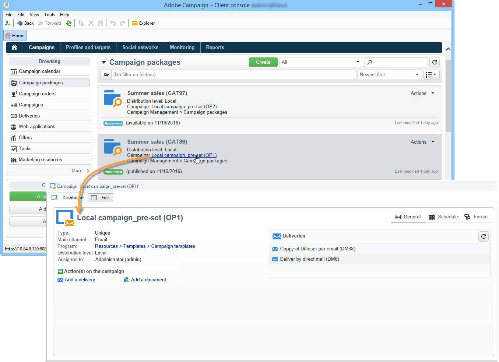

# Accedere alle campagne{#accessing-campaigns}

Una volta ordinata una campagna, l’ordine è stato approvato e la data di disponibilità è stata raggiunta, è possibile eseguirlo.

A seconda del tipo di campagna e delle opzioni selezionate, la campagna viene eseguita in locale o a livello centrale.

## Accedere alla campagna {#accessing-the-campaign}

Una volta che l’ordine è stato approvato e la data di disponibilità è stata raggiunta, la campagna viene creata in locale e può essere utilizzata. Gli operatori locali vengono informati della sua disponibilità.

Viene aggiunto ai dettagli dell’ordine corrispondente e può essere modificato. La dashboard completa consente di gestirla a livello locale.

La campagna rimane accessibile nella panoramica della campagna, che si trova tramite il collegamento **[!UICONTROL Campaigns]** nella home page.

## Impostazioni disponibili {#available-settings}

Le entità locali possono adattare il contenuto della campagna in base alle proprie esigenze, utilizzando tutti gli elementi del dashboard della campagna. Il loro compito principale sarà adattare il flusso di lavoro di targeting ed eventualmente personalizzare il contenuto della consegna.

## Esecuzione della campagna {#campaign-execution}

Ogni entità locale può eseguire il flusso di lavoro della campagna ed eseguire le approvazioni necessarie in base al processo definito nel modello della campagna.
