# Creare una campagna locale{#creating-a-local-campaign}

Una campagna locale è un&#39;istanza creata da un modello a cui si fa riferimento nell&#39;elenco di **[!UICONTROL campaign packages]** con una **pianificazione di esecuzione specifica**. Il suo obiettivo è soddisfare una necessità di comunicazione locale utilizzando un modello di campagna configurato e configurato dall’entità centrale. Le fasi principali per l&#39;attuazione di un&#39;operazione locale sono le seguenti:

**Per l&#39;entità centrale**

1. Creazione di un modello di campagna locale.
1. Creazione di un pacchetto di campagna da un modello.
1. Pubblicazione di un pacchetto della campagna.
1. Approvazione degli ordini.

**Per l&#39;entità locale**

1. Ordinamento della campagna.
1. Esecuzione di campagne.

## Creazione di un modello di campagna locale {#creating-a-local-campaign-template}

Per creare un pacchetto della campagna, devi innanzitutto creare il **modello della campagna** tramite il nodo **[!UICONTROL Resources > Templates]**.

Per creare un nuovo modello locale, duplicare il modello predefinito **[!UICONTROL Local campaign (opLocal)]**.

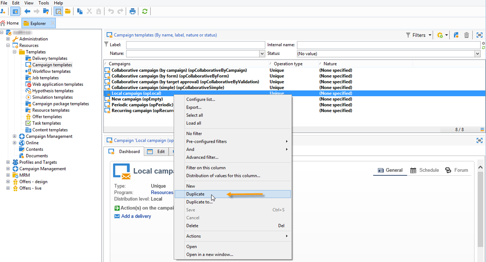

Denomina il modello della campagna e completa i campi disponibili.

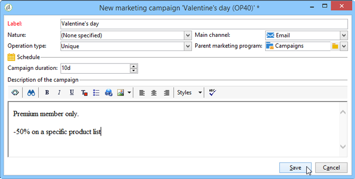

Nella finestra della campagna, fai clic sulla scheda **[!UICONTROL Edit]**, quindi sul collegamento **[!UICONTROL Advanced campaign parameters...]**.

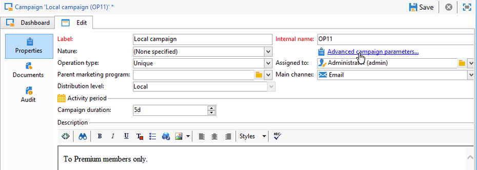

### Interfaccia Web {#web-interface}

Nella scheda **Marketing distribuito** è possibile scegliere il tipo di interfaccia Web e specificare i valori e i parametri predefiniti da immettere quando un&#39;entità locale effettua un ordine.

L’interfaccia web corrisponde a un modulo che l’entità locale deve compilare quando ordina la campagna.

Seleziona il tipo di interfaccia web da applicare alle campagne create dal modello:

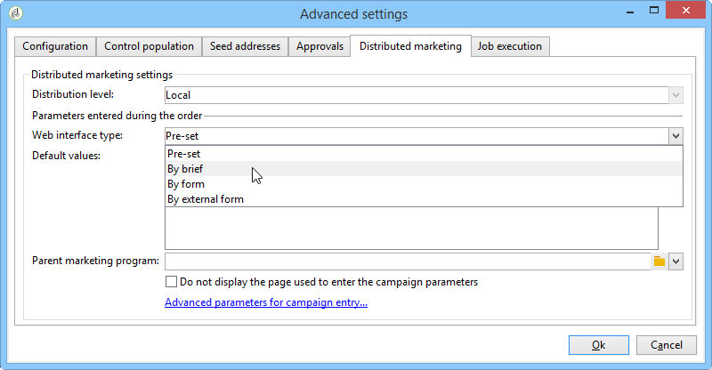

Sono disponibili quattro tipi di interfacce web:

* **[!UICONTROL By brief]**: l&#39;entità locale deve fornire una descrizione che descriva le configurazioni della campagna. Una volta approvato l’ordine, l’entità centrale configura ed esegue la campagna nel suo insieme.

  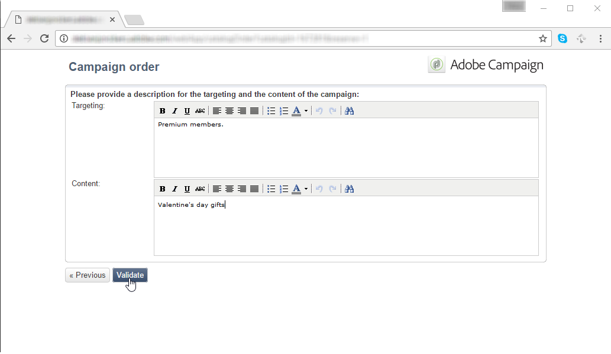

* **[!UICONTROL By form]**: l&#39;entità locale ha accesso a un modulo web in cui, a seconda del modello utilizzato, può modificare il contenuto, la destinazione, la sua dimensione massima, nonché le date di creazione ed estrazione utilizzando i campi di personalizzazione. L’entità locale può valutare la destinazione e visualizzare in anteprima il contenuto di questo modulo web.

  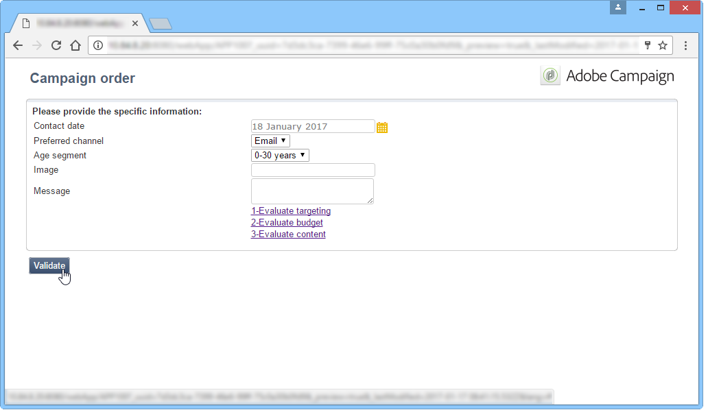

  Il modulo offerto è specificato in un&#39;applicazione Web che deve essere selezionata in un elenco a discesa dal campo **[!UICONTROL web Interface]** nel collegamento **[!UICONTROL Advanced campaign parameters...]** del modello. Consulta [Creazione di una campagna locale (per modulo)](examples.md#creating-a-local-campaign--by-form-).

  >[!NOTE]
  >
  >L’applicazione web utilizzata in questo esempio è un esempio. Devi creare un’app web specifica per poter utilizzare un modulo.

  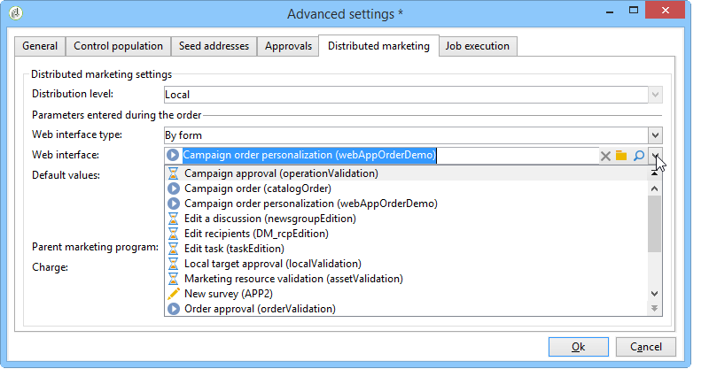

* **[!UICONTROL By external form]**: l&#39;entità locale ha accesso ai parametri della campagna nella sua extranet (non Adobe Campaign). Questi parametri sono identici a quelli di una **campagna locale (per modulo)**.
* **[!UICONTROL Pre-set]**: l&#39;entità locale ordina la campagna utilizzando il modulo predefinito, senza localizzarlo.

  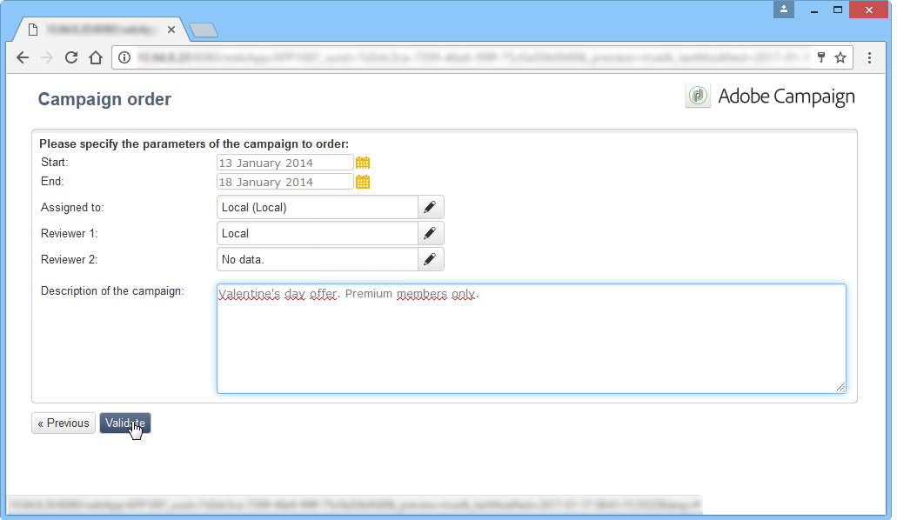

### Valori predefiniti {#default-values}

Selezionare **[!UICONTROL Default values]** che deve essere completato dalle entità locali. Ad esempio:

* date di contatto e di estrazione,
* caratteristiche del target (segmento di età, ecc.).

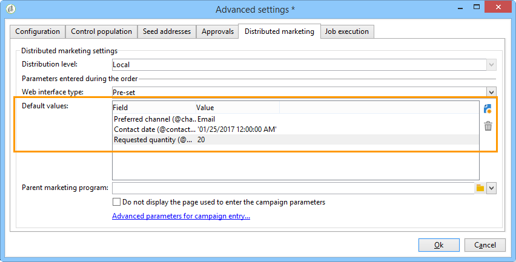

Completare i campi **[!UICONTROL Parent marketing program]** e **[!UICONTROL Charge]**.

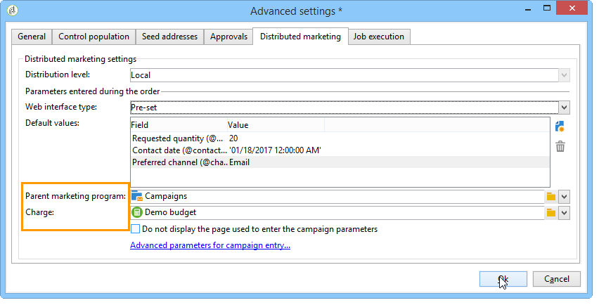

### Approvazioni {#approvals}

Dal collegamento **[!UICONTROL Advanced parameters for campaign entry]**, puoi specificare il numero massimo di revisori.

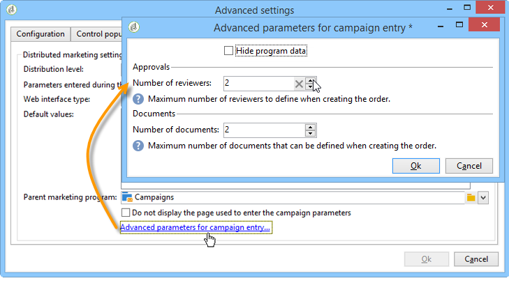

I revisori verranno inseriti dall&#39;entità locale quando si ordina la campagna.

Se non desideri assegnare un nome ai revisori per una campagna, immetti 0.

### Documenti {#documents}

Puoi consentire agli operatori di entità locali di collegare documenti (file di testo, fogli di calcolo, immagini, descrizioni di campagne, ecc.) alla campagna locale durante la creazione dell’ordine. Il collegamento **[!UICONTROL Advanced parameters for campaign entry...]** consente di limitare il numero di documenti. A questo scopo, è sufficiente immettere il numero massimo consentito nel campo **[!UICONTROL Number of documents]**.

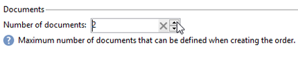

Quando si ordina un pacchetto della campagna, il modulo suggerisce di collegare tutti i documenti come indicato nel campo corrispondente nel modello.

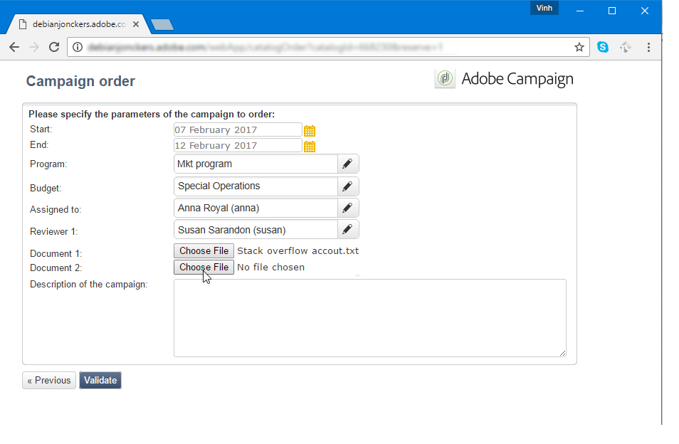

Se non si desidera visualizzare un campo di caricamento documento, immettere **[!UICONTROL 0]** nel campo **[!UICONTROL Number of documents]**.

>[!NOTE]
>
>È possibile disattivare **[!UICONTROL Advanced parameters for campaign entry]** controllando **[!UICONTROL Do not display the page used to enter the campaign parameters]**.

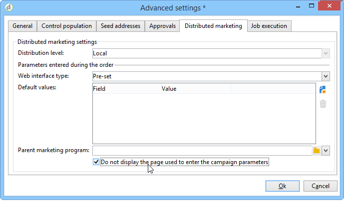

### Flusso di lavoro {#workflow}

Nella scheda **[!UICONTROL Targeting and workflows]**, crea il flusso di lavoro della campagna che raccoglie **[!UICONTROL Default values]** specificato in **[!UICONTROL Advanced campaign parameters...]** e crea le consegne.

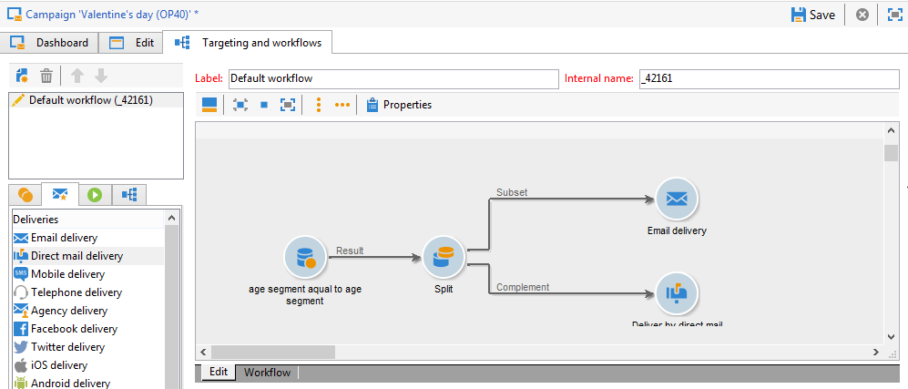

Fare doppio clic sull&#39;attività **[!UICONTROL Query]** per configurarla in base all&#39;attività **[!UICONTROL Default values]** specificata.

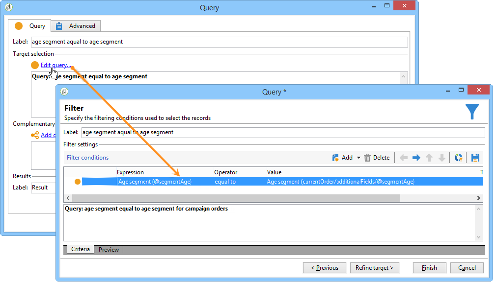

### Consegna {#delivery}

Nella scheda **[!UICONTROL Audit]**, fai clic sull&#39;icona **[!UICONTROL Detail...]** per visualizzare **[!UICONTROL Scheduling]** per la consegna selezionata.

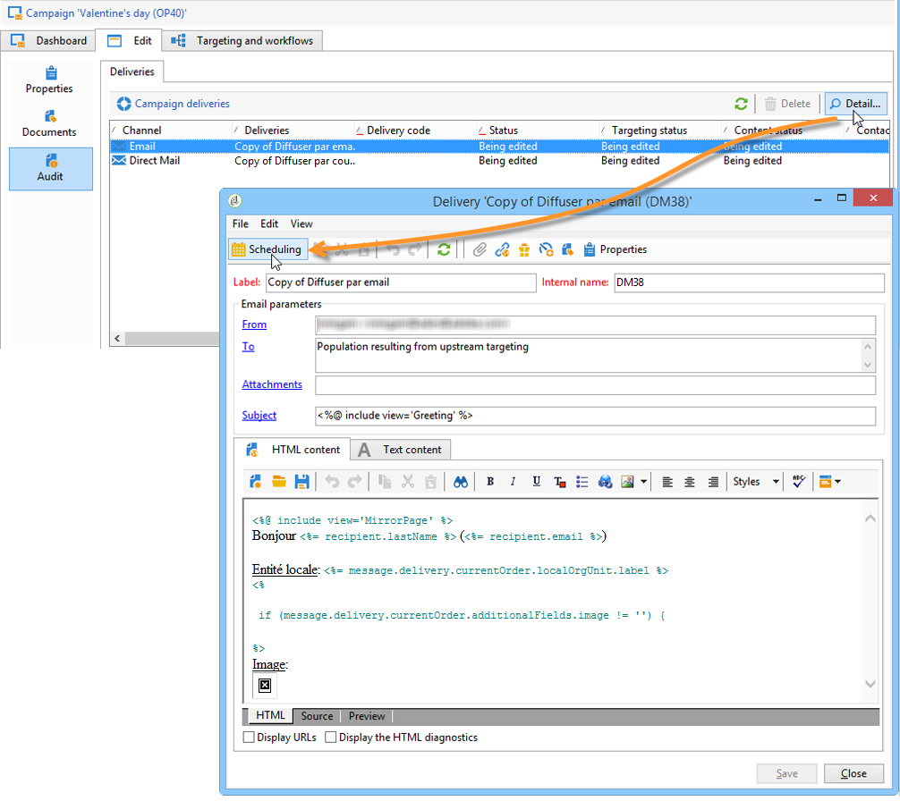

L’icona **[!UICONTROL Scheduling]** ti consente di configurare il contatto e la data di esecuzione della consegna.

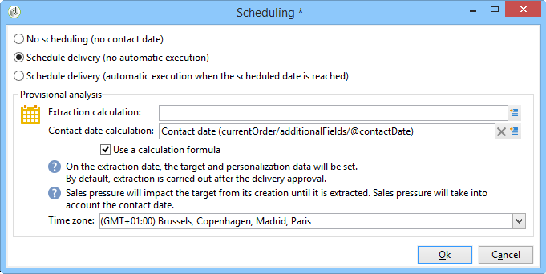

Se necessario, configura la dimensione massima della consegna:

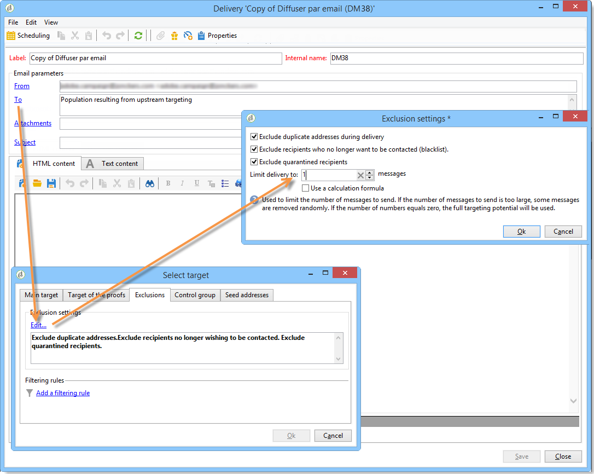

Individua il HTML della consegna. Ad esempio, in **[!UICONTROL Delivery > Current order > Additional fields]**, utilizza il campo **[!UICONTROL Age segment]** per individuare la consegna in base all&#39;età della destinazione.

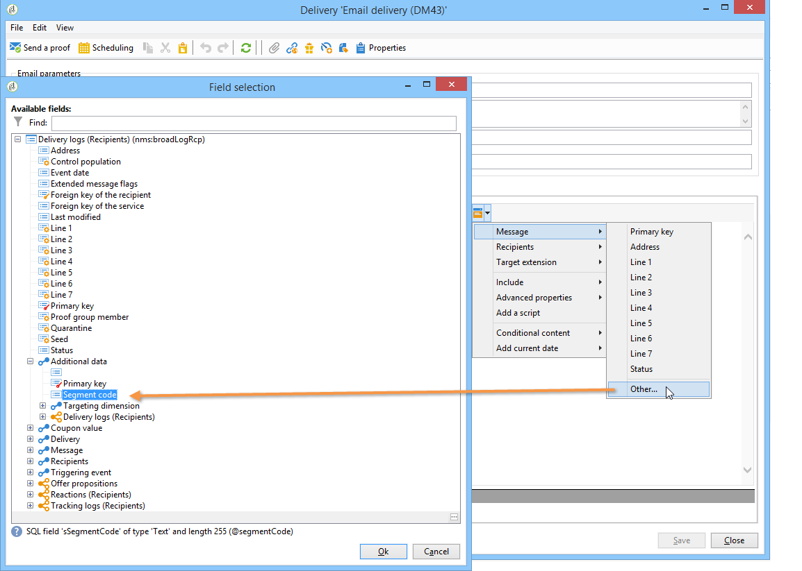

Salva il modello della campagna. È ora possibile utilizzarlo dalla visualizzazione **[!UICONTROL Campaign packages]** nella scheda **[!UICONTROL Campaigns]** facendo clic sul pulsante **[!UICONTROL Create]**.

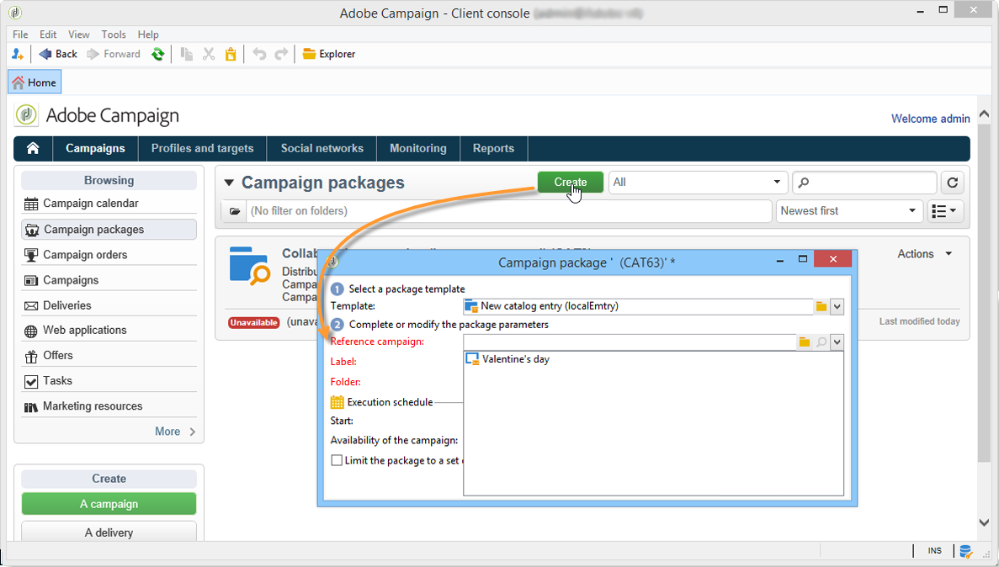

>[!NOTE]
>
>I modelli di campagna e la relativa configurazione generale sono descritti in dettaglio in [Modelli di campagna di marketing](../campaigns/marketing-campaign-templates.md).

## Creazione del pacchetto della campagna {#creating-the-campaign-package}

Affinché il modello della campagna diventi disponibile per le entità locali, è necessario aggiungerlo all’elenco. Per farlo, l&#39;agenzia centrale deve creare un nuovo pacchetto.

Applica i seguenti passaggi:

1. Nella sezione **[!UICONTROL Navigation]** della pagina **Campagne**, fai clic sul collegamento **[!UICONTROL Campaign packages]**.
1. Fai clic sul pulsante **[!UICONTROL Create]**.

   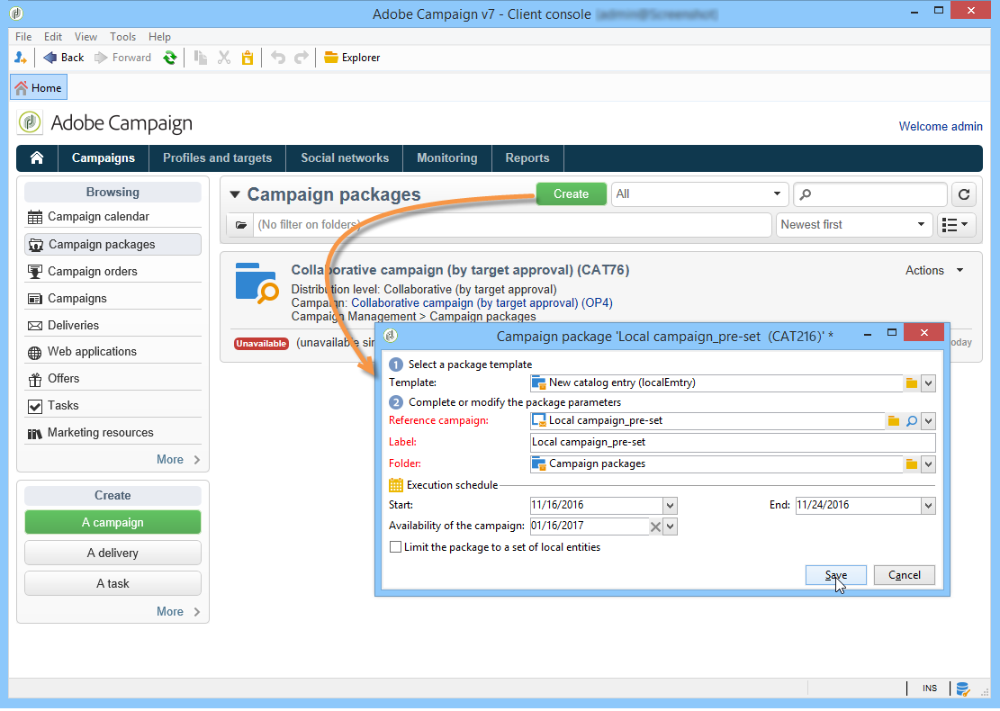

1. La sezione sopra la finestra consente di selezionare il modello di pacchetto della campagna [precedentemente](#creating-a-local-campaign-template) specificato.

   Per impostazione predefinita, il modello **[!UICONTROL New local campaign package (localEmpty)]** viene utilizzato per le campagne locali.

1. Specifica l’etichetta, la cartella e la pianificazione di esecuzione per il pacchetto della campagna.

### Date {#dates}

Le date di inizio e di fine definiscono il periodo di visibilità della campagna nell’elenco dei pacchetti della campagna.

La data di disponibilità è la data in cui la campagna diventerà disponibile per le entità locali (per l&#39;ordine).

>[!CAUTION]
>
>Se un’entità locale non riserva la campagna prima della scadenza, non potrà utilizzarla.

Queste informazioni si trovano nel messaggio di notifica inviato alle agenzie locali, come mostrato di seguito:

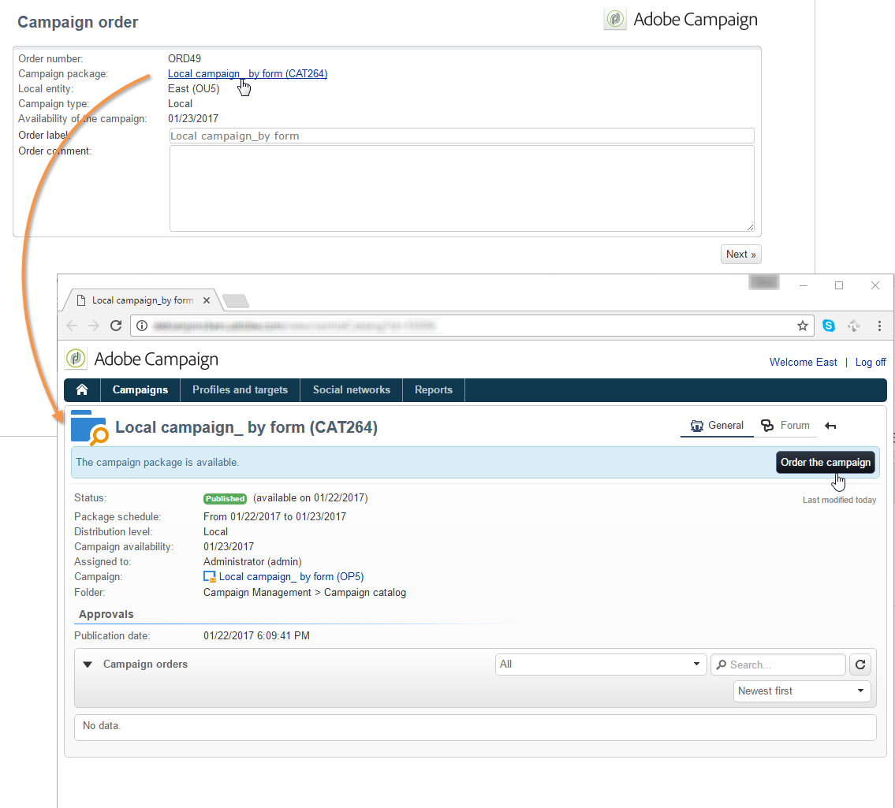

### Pubblico {#audience}

Per una campagna locale, l&#39;entità centrale può specificare le entità locali coinvolte controllando **[!UICONTROL Limit the package to a set of local entities]**.

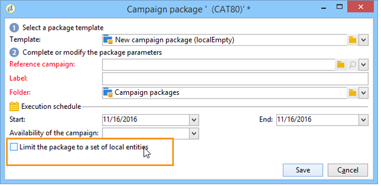

### Impostazioni aggiuntive {#additional-settings}

Una volta salvato il pacchetto, l&#39;entità centrale può modificarlo dalla scheda **[!UICONTROL Edit]**.

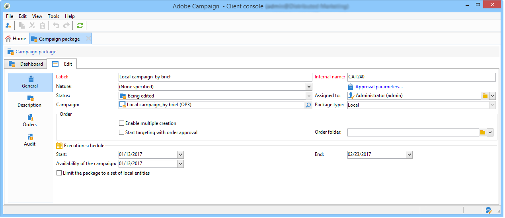

Dalla scheda **[!UICONTROL General]**, l&#39;entità centrale può:

* configurare i revisori del pacchetto campaign dal collegamento **[!UICONTROL Approval parameters...]**,
* rivedere il programma di esecuzione,
* aggiungere o eliminare entità locali.

>[!NOTE]
>
>Per impostazione predefinita, ogni entità può ordinare una **campagna locale** una sola volta.
>   
>Seleziona l&#39;opzione **[!UICONTROL Enable multiple creation]** per consentire la creazione di diverse campagne locali dal pacchetto della campagna.

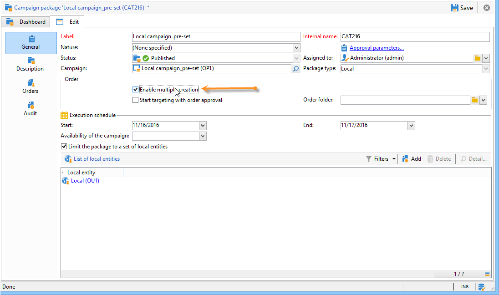

### Notifiche {#notifications}

Quando una campagna diventa disponibile o viene raggiunto il termine di registrazione, viene inviato un messaggio agli operatori del gruppo di notifica locale. Per ulteriori informazioni, consulta [Entità organizzative](about-distributed-marketing.md#organizational-entities).

## Ordinamento di una campagna {#ordering-a-campaign}

I pacchetti di campagne diventano accessibili alle entità locali dopo che sono stati approvati e il loro periodo di implementazione è iniziato. Le entità locali ricevono un’e-mail che informa sulla disponibilità di un nuovo pacchetto della campagna (non appena viene raggiunta la data di disponibilità).

>[!NOTE]
>
>Se durante la creazione del pacchetto della campagna sono state specificate alcune entità locali, queste saranno le uniche a ricevere una notifica. Se non è stata specificata alcuna entità locale, tutte le entità locali riceveranno una notifica.

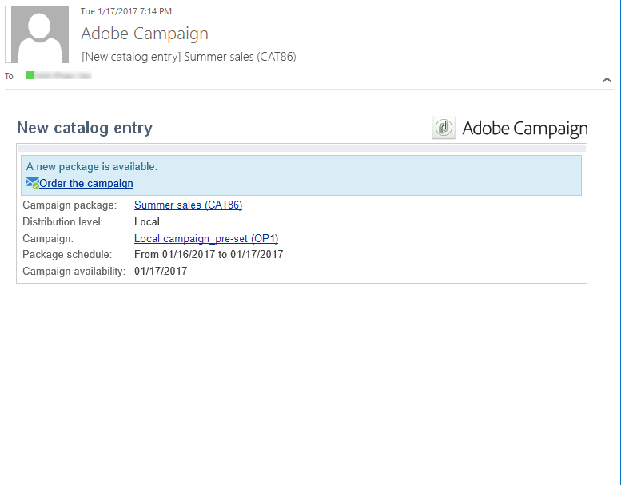

Per utilizzare una campagna offerta dall&#39;entità centrale, l&#39;entità locale deve ordinarla.

Per ordinare una campagna:

1. Fare clic su **[!UICONTROL Order campaign]** nel messaggio di notifica o sul pulsante corrispondente in Adobe Campaign.

   Immetti ID e password per ordinare la campagna. L’interfaccia è costituita da un set di pagine definite in un’applicazione web.

1. Immettere le informazioni necessarie nella prima pagina (etichetta ordine e commento) e fare clic su **[!UICONTROL Next]**.

   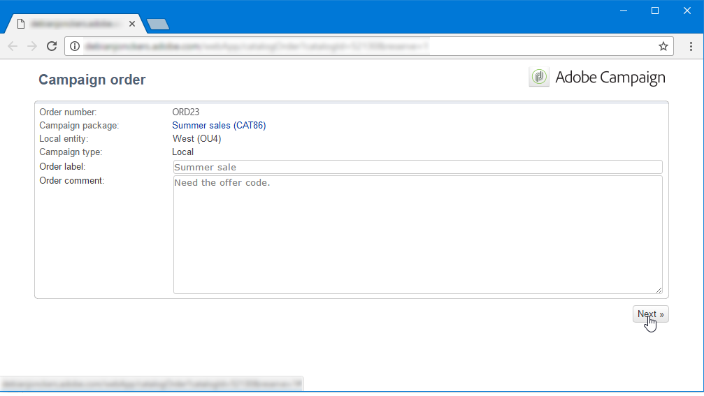

1. Completa i parametri disponibili e approva l’ordine.

1. Al manager dell&#39;entità organizzativa a cui appartiene l&#39;entità locale viene inviata una notifica per approvare l&#39;ordine.

   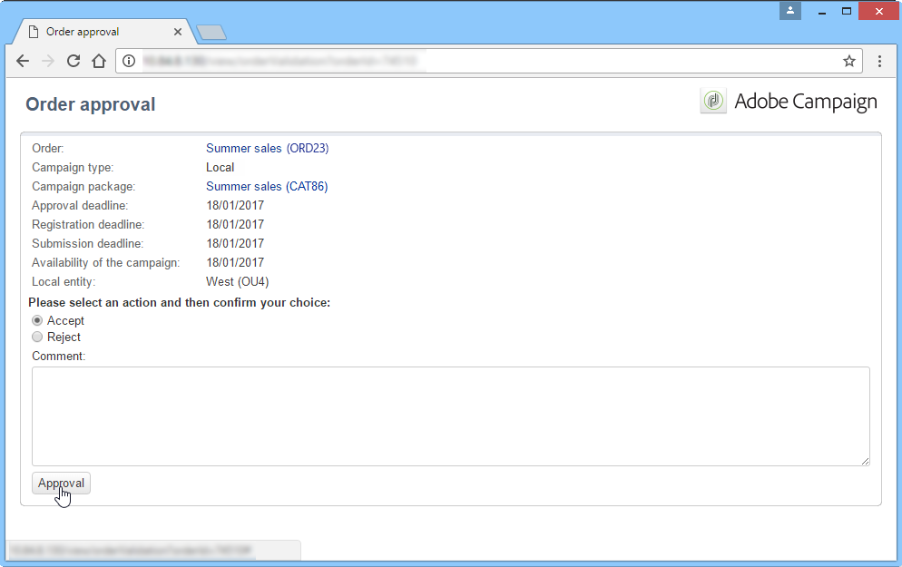

1. Le informazioni vengono restituite agli enti locali e centrali. Mentre le entità locali possono visualizzare solo i propri ordini, l&#39;entità centrale può visualizzare tutti gli ordini per qualsiasi entità locale, come illustrato di seguito:

   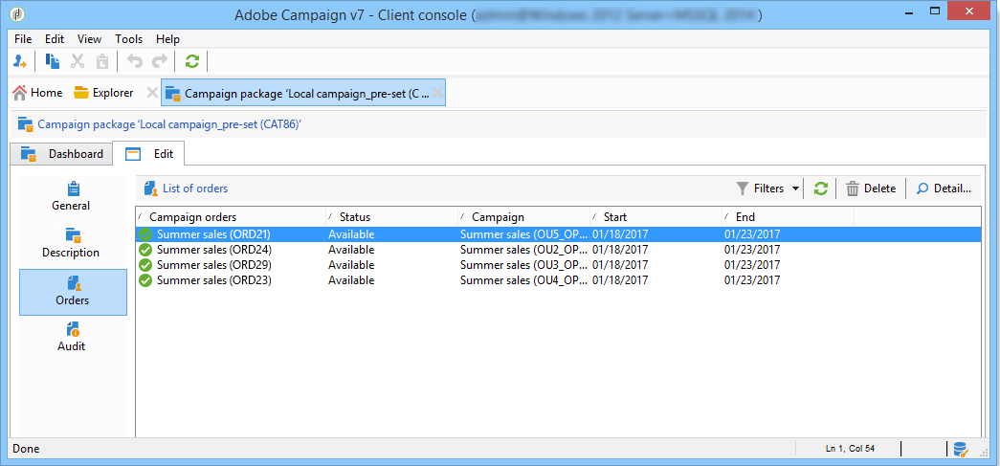

   Gli operatori possono visualizzare i dettagli dell’ordine:

   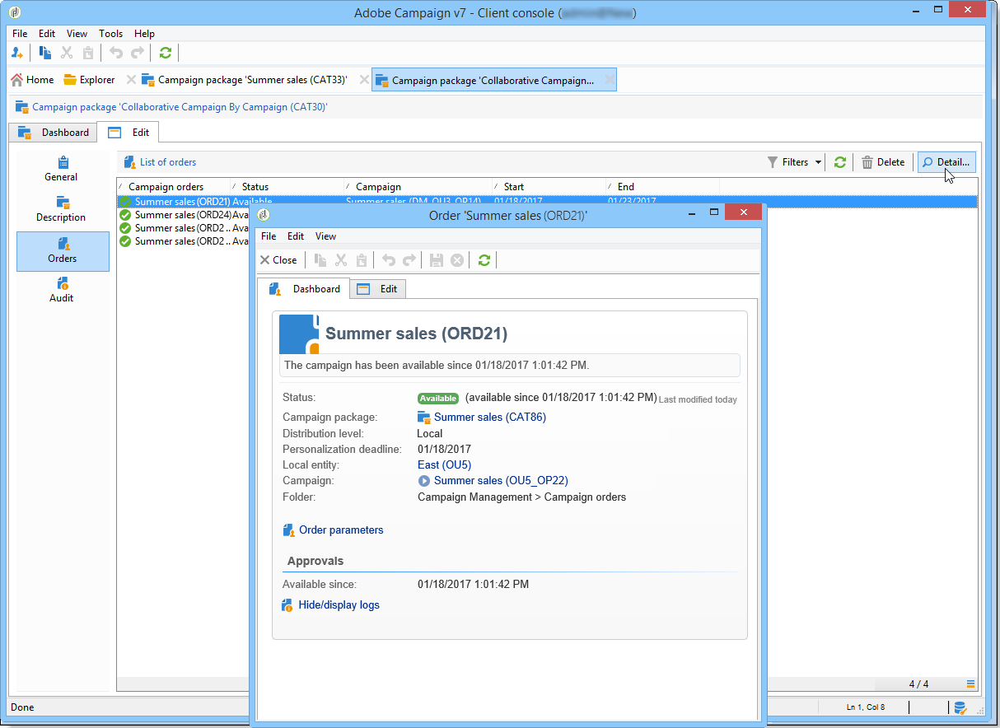

   La scheda **[!UICONTROL Edit]** contiene le informazioni immesse dall&#39;entità locale durante l&#39;ordinamento della campagna.

   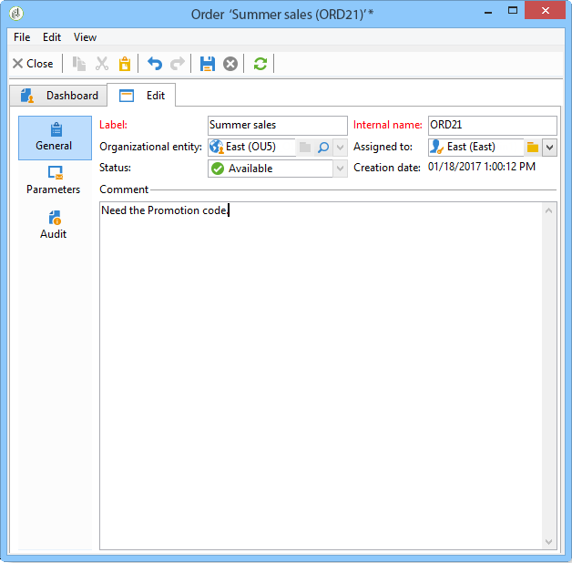

1. L&#39;ordine deve essere approvato dall&#39;entità centrale per essere finalizzato.

   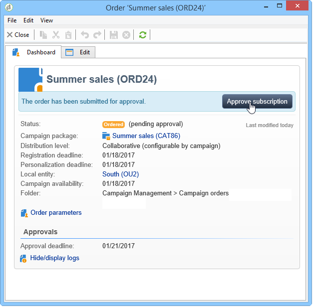

   Per ulteriori informazioni, consulta la sezione [Processo di approvazione](#approval-process).

1. L&#39;operatore locale viene quindi informato che la campagna è disponibile: la disponibilità della campagna si trova nell&#39;elenco dei pacchetti della campagna nella scheda **Campagne**. È quindi possibile utilizzare la campagna. Per ulteriori informazioni, consulta [Accesso alle campagne](accessing-campaigns.md).

   L&#39;opzione **[!UICONTROL Start targeting with order approval]** consente all&#39;entità locale di eseguire la campagna non appena l&#39;ordine è stato approvato.

   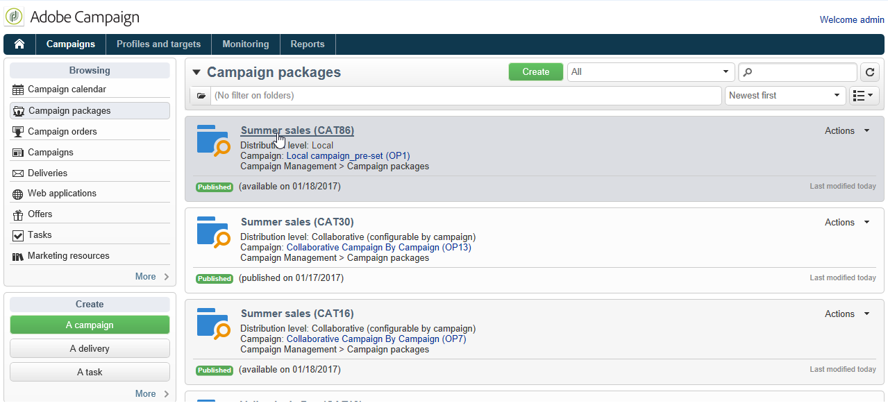

## Approvazione di un ordine {#approving-an-order}

Per confermare un ordine della campagna, l’entità centrale deve approvarlo.

La panoramica di **[!UICONTROL Campaign orders]**, accessibile tramite la scheda **Campagne**, consente di visualizzare lo stato degli ordini delle campagne e di approvarli.

>[!NOTE]
>
>Le entità locali possono apportare modifiche all&#39;ordine fino a quando non viene approvato.

### Processo di approvazione {#approval-process}

#### Notifica e-mail {#email-notification}

Quando una campagna viene ordinata da un’entità locale, i revisori vengono avvisati via e-mail, come illustrato di seguito:

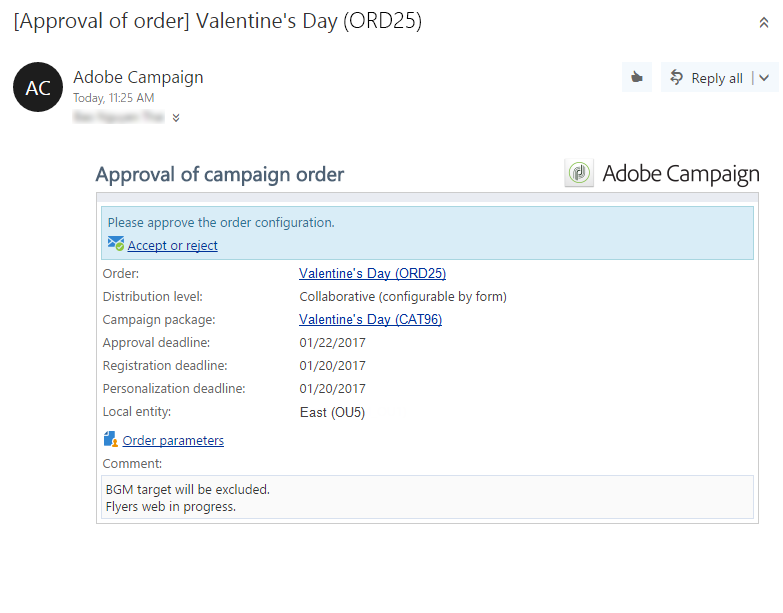

>[!NOTE]
>
>La selezione dei revisori è presentata nella sezione [Revisori](#reviewers). Possono accettare o rifiutare l’ordine.

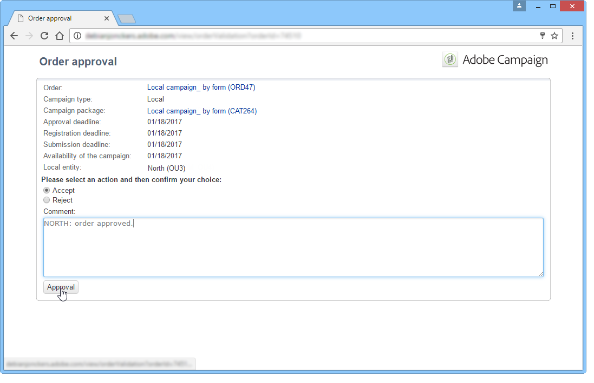

#### Approva tramite la console client {#approving-via-the-adobe-campaign-console}

L’ordine può essere approvato anche tramite la console client, nella panoramica dell’ordine della campagna. Per approvare un ordine, selezionarlo e fare clic su **[!UICONTROL Approve the order]**.

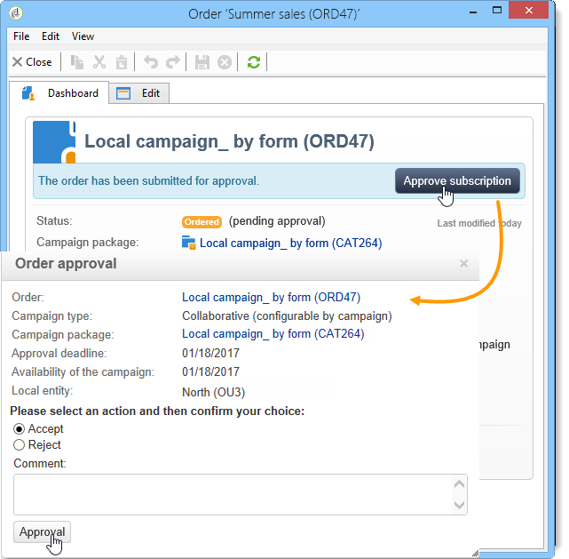

>[!NOTE]
>
>È comunque possibile modificare e riconfigurare la campagna fino alla data di disponibilità. Le entità locali possono inoltre rifiutare la campagna facendo clic sul pulsante **[!UICONTROL Cancel]**.

#### Creazione di una campagna {#creating-a-campaign}

Una volta approvato, l’ordine di una campagna può essere configurato ed eseguito dall’entità locale.

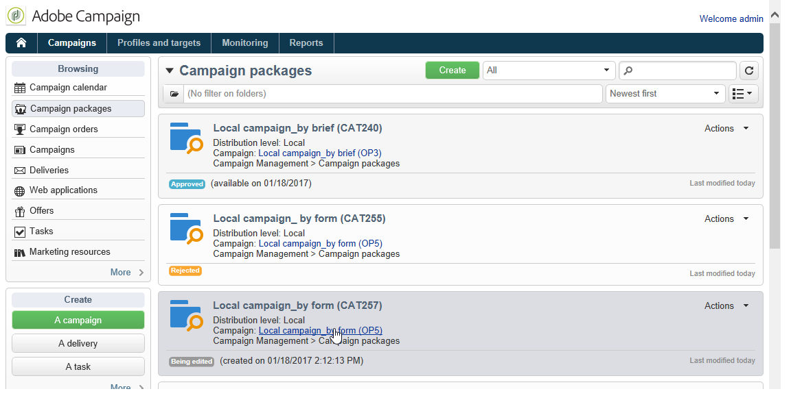

Per ulteriori informazioni, consulta [Accesso alle campagne](accessing-campaigns.md).

### Rifiuto di un’approvazione {#rejecting-an-approval}

L’operatore responsabile dell’approvazione può rifiutare un ordine o un pacchetto della campagna.

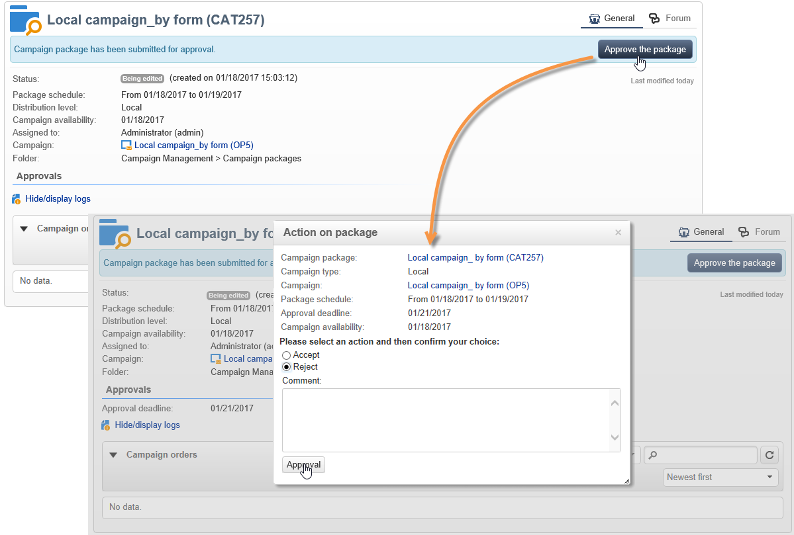

Se il revisore rifiuta un ordine, la relativa notifica viene inviata automaticamente alle entità locali interessate: viene visualizzato il commento inserito dall’operatore che ha rifiutato l’approvazione.

Le informazioni vengono visualizzate nell’elenco della pagina dei pacchetti della campagna o nella pagina dell’ordine della campagna. Se hanno accesso alla console client di Adobe Campaign, le entità locali vengono informate di questo rifiuto.

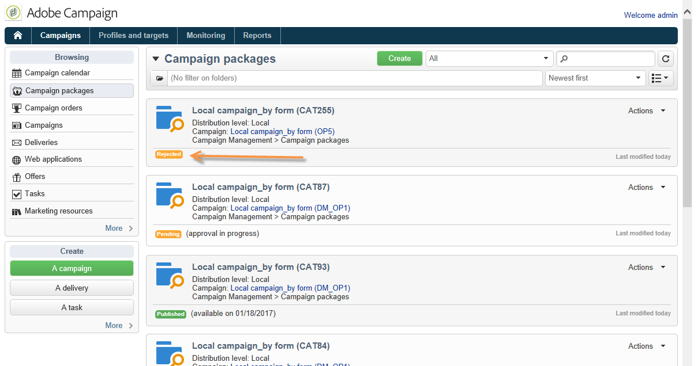

Possono visualizzare il commento correlato nella scheda **[!UICONTROL Edit]** del pacchetto della campagna.

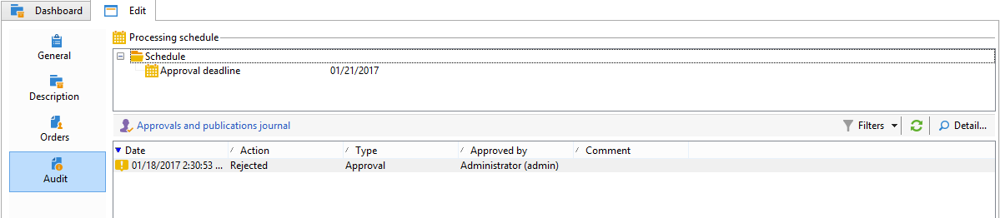

### Revisori {#reviewers}

Ogni volta che è richiesta un’approvazione, i revisori ricevono una notifica via e-mail.

Per ogni entità locale, i revisori vengono selezionati per l’approvazione dell’ordine della campagna e della campagna. Per ulteriori informazioni sulla selezione dei revisori locali, consultare [Entità organizzative](about-distributed-marketing.md#organizational-entities).

>[!NOTE]
>
>Affinché questa selezione sia possibile, l&#39;approvazione dell&#39;ordine non deve ancora essere effettiva.

### Annullamento di un ordine {#canceling-an-order}

L&#39;agenzia centrale può annullare un ordine utilizzando il pulsante **[!UICONTROL Delete]**, che si trova nel dashboard dell&#39;ordine.

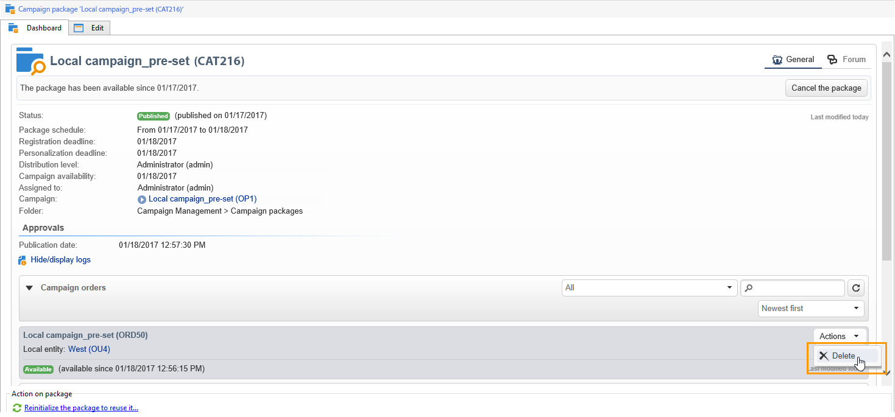

La campagna verrà annullata nella visualizzazione **[!UICONTROL Campaign orders]**.
