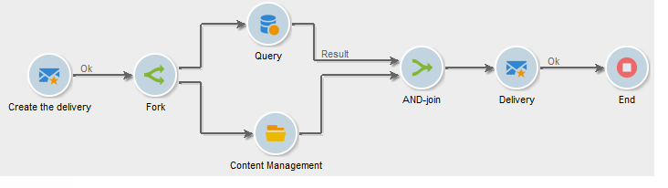

# AND-join{#and-join}

Un join attiva la relativa transizione in uscita solo quando vengono attivate tutte le transizioni in entrata, ovvero quando tutte le attività precedenti sono state completate. Questo consente di verificare che alcune attività siano state completate prima di continuare a eseguire il flusso di lavoro.

Ad esempio, puoi utilizzare un’attività AND-join nel contesto della creazione di contenuti e dell’automazione dell’invio della consegna, per assicurarti che una consegna venga avviata solo una volta completati i passaggi di query di destinazione e aggiornamenti dei contenuti. Un caso d’uso dedicato è disponibile in

>[!NOTE]
>
>Le transizioni in entrata configurate con dimensioni di targeting diverse non possono essere unite insieme utilizzando un&#39;attività **[!UICONTROL AND-join]**.

La popolazione in uscita inviata dell’attività è determinata scegliendo un set principale tra le transizioni in entrata nell’attività.

La transizione in uscita può contenere solo una delle popolazioni di transizione in entrata. Se l’attività non è configurata, la transizione in uscita selezionerà in modo casuale una delle popolazioni in entrata.

>[!CAUTION]
>
>Nel caso di attività di tipo **AND-join**, le variabili evento vengono unite ma se viene definita due volte la stessa variabile, si verifica un conflitto e il valore rimane indeterminato. Per ulteriori informazioni, consulta [Variabili evento](javascript-scripts-and-templates.md#event-variables).
