# Flusso di lavoro per consegna cross-channel{#cross-channel-delivery-workflow}

Questo caso d’uso presenta un esempio che coinvolge un flusso di lavoro di consegna cross-channel. Il concetto generale delle consegne cross-channel è presentato in [questa sezione](cross-channel-deliveries.md).

L’obiettivo è segmentare un pubblico dai destinatari del database in gruppi diversi, allo scopo di inviare un’e-mail a un gruppo e un messaggio SMS a un altro gruppo.

I passaggi principali di implementazione per questo caso d’uso sono i seguenti:

1. Creazione di un&#39;attività **[!UICONTROL Query]** per eseguire il targeting del pubblico.
1. Creazione di un&#39;attività **[!UICONTROL Email delivery]** contenente un collegamento a un&#39;offerta.
1. Utilizzo di un&#39;attività **[!UICONTROL Split]** per:

   * Invia un’altra e-mail ai destinatari che non hanno aperto la prima e-mail.
   * Invia un SMS ai destinatari che hanno aperto l’e-mail ma non hanno fatto clic sul collegamento all’offerta.
   * Aggiungi al database i destinatari che hanno aperto l’e-mail e fatto clic sul collegamento.

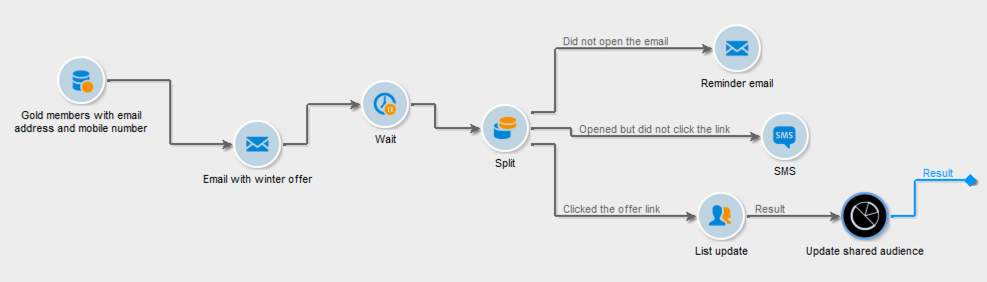

## Passaggio 1: creare il pubblico {#step-1--build-the-audience}

Per definire il target, crea una query per identificare i destinatari.

1. Creare una campagna. Ulteriori informazioni in [Creare campagne di marketing](../campaigns/marketing-campaign-create.md).
1. Nella scheda **[!UICONTROL Targeting and workflows]** della campagna, aggiungi un&#39;attività **Query** al flusso di lavoro. Per ulteriori informazioni sull&#39;utilizzo di questa attività, consulta [questa sezione](query.md).
1. Definisci i destinatari che riceveranno le consegne. Ad esempio, selezionare membri &quot;Gold&quot; come dimensione di destinazione.
1. Aggiungi condizioni di filtro alla query. In questo esempio, seleziona i destinatari che dispongono di un indirizzo e-mail e di un numero di cellulare.

   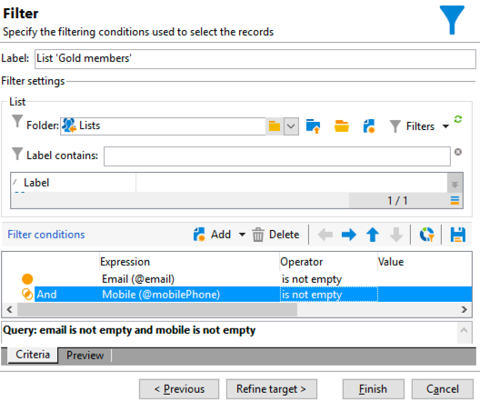

1. Salva le modifiche.

## Passaggio 2: creare un’e-mail che includa un’offerta {#step-2--create-an-email-including-an-offer}

1. Creare una consegna e-mail.
1. Progetta il messaggio e inserisci un collegamento che includa un’offerta nel contenuto.

   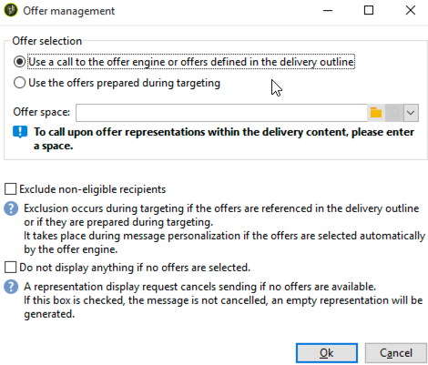

   Per ulteriori informazioni sull&#39;integrazione di un&#39;offerta nel corpo di un messaggio, consulta [Inviare e-mail con Adobe Campaign](../../v8/send/email.md).

1. Salva le modifiche.
1. Fare clic con il pulsante destro del mouse sull&#39;attività **[!UICONTROL Email delivery]** per aprirla.
1. Selezionare l&#39;opzione **[!UICONTROL Generate an outbound transition]** per recuperare la popolazione e i registri di tracciamento.

   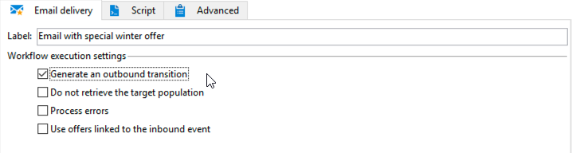

   Questo ti consentirà di utilizzare queste informazioni per inviare un’altra consegna a seconda del comportamento dei destinatari al momento della ricezione della prima e-mail.

1. Aggiungi un&#39;attività **[!UICONTROL Wait]** per consentire ai destinatari di aprire l&#39;e-mail per alcuni giorni.

   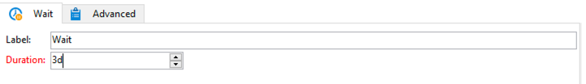

## Passaggio 3: segmentare il pubblico risultante {#step-3--segment-the-resulting-audience}

Una volta identificata la destinazione e creata la prima consegna, devi segmentarla in popolazioni diverse utilizzando condizioni di filtro.

1. Aggiungi un&#39;attività **Split** al flusso di lavoro e aprila. Per ulteriori informazioni sull&#39;utilizzo di questa attività, consulta [questa sezione](split.md).
1. Crea tre segmenti dalla popolazione calcolata a monte nella query.

   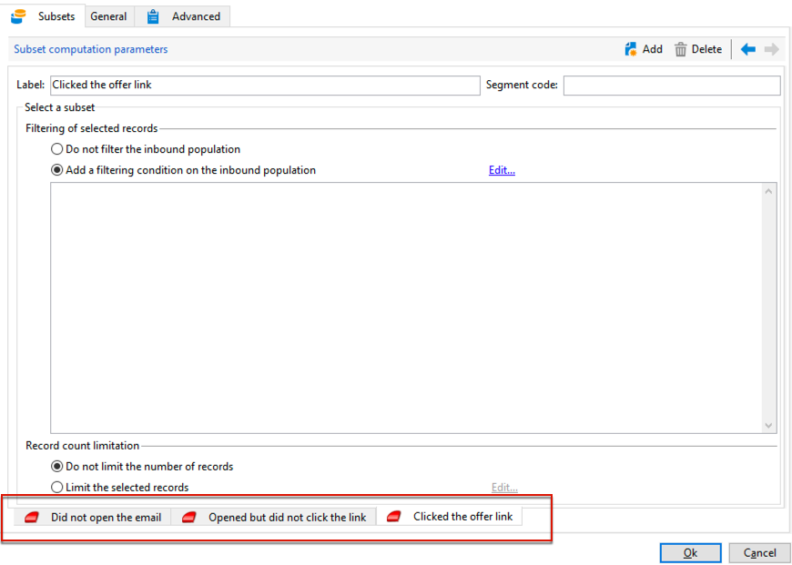

1. Per il primo sottoinsieme, selezionare l&#39;opzione **[!UICONTROL Add a filtering condition on the inbound population]** e fare clic su **[!UICONTROL Edit]**.

   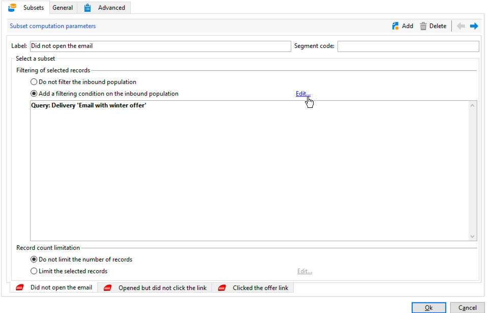

1. Selezionare **[!UICONTROL Recipients of a delivery]** come filtro di restrizione e fare clic su **[!UICONTROL Next]**.

   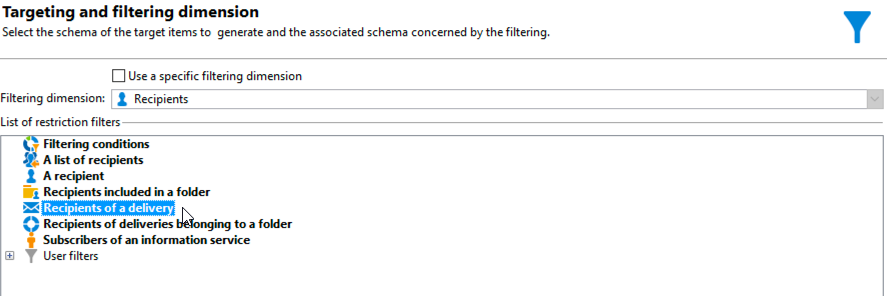

1. Nelle impostazioni del filtro, selezionare **[!UICONTROL Recipients who have not opened or clicked (email)]** dall&#39;elenco a discesa **[!UICONTROL Behavior]** e selezionare l&#39;e-mail che include l&#39;offerta che si desidera inviare dall&#39;elenco di consegna. Fai clic su **[!UICONTROL Finish]**.

   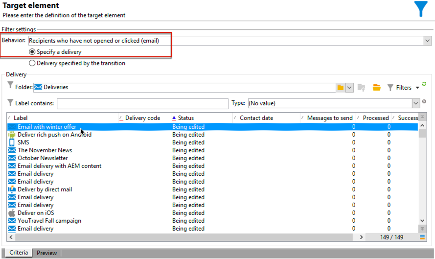

1. Procedere in modo simile per il secondo sottoinsieme e selezionare **[!UICONTROL Recipients who have not clicked (email)]** dall&#39;elenco a discesa **[!UICONTROL Behavior]**.

   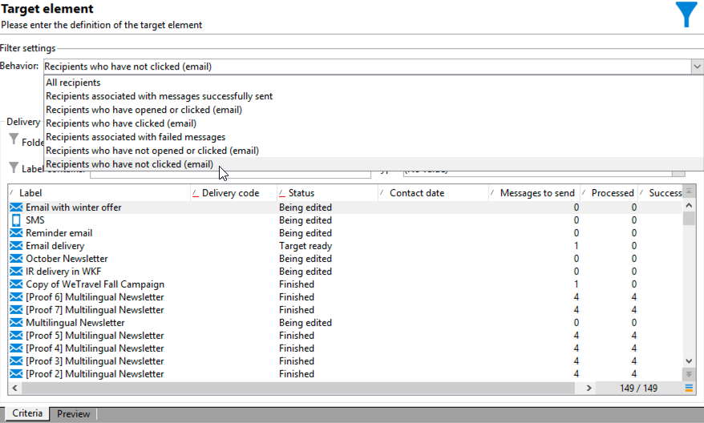

1. Per il terzo sottoinsieme, dopo aver selezionato **[!UICONTROL Add a filtering condition on the inbound population]** e aver fatto clic su **[!UICONTROL Edit]**, selezionare l&#39;opzione **[!UICONTROL Use a specific filtering dimension]**.
1. Selezionare **[!UICONTROL Recipient tracking log]** dall&#39;elenco a discesa **[!UICONTROL Filtering dimension]**, evidenziare **[!UICONTROL Filtering conditions]** da **[!UICONTROL List of restriction filters]** e fare clic su **[!UICONTROL Next]**.

   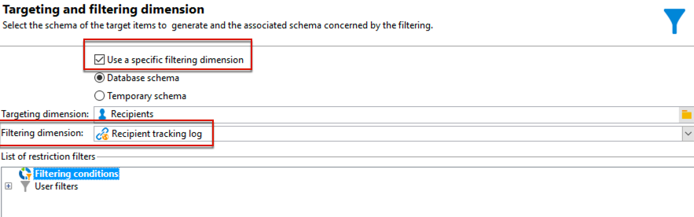

1. Seleziona le condizioni del filtro come segue:

   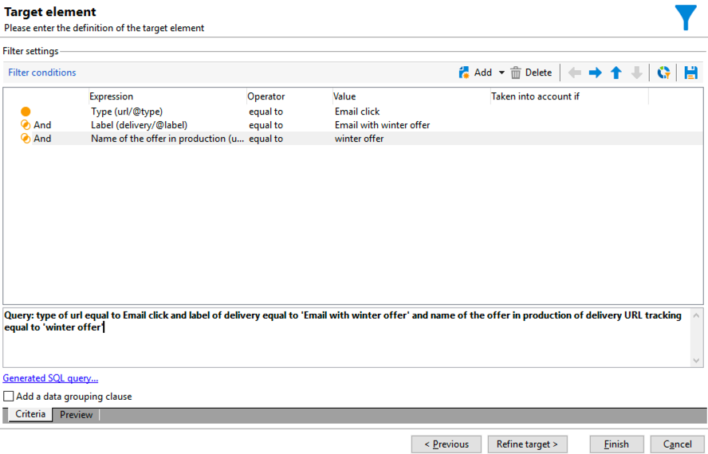

1. Fai clic su **[!UICONTROL Finish]** per salvare le modifiche.

## Passaggio 4: finalizzare il flusso di lavoro {#step-4--finalize-the-workflow}

1. Aggiungi le attività rilevanti al flusso di lavoro dopo i tre sottoinsiemi risultanti dall&#39;attività **[!UICONTROL Split]**:

   * Aggiungi un&#39;attività **[!UICONTROL Email delivery]** per inviare un promemoria e-mail al primo sottoinsieme.
   * Aggiungere un&#39;attività **[!UICONTROL Mobile delivery]** per inviare un messaggio SMS al secondo sottoinsieme.
   * Aggiungere un&#39;attività **[!UICONTROL List update]** per aggiungere i destinatari corrispondenti al database.

1. Fai doppio clic sulle attività di consegna nel flusso di lavoro per modificarle.
1. Fare doppio clic sull&#39;attività **[!UICONTROL List update]** e selezionare l&#39;opzione **[!UICONTROL Generate an outbound transition]**.
1. Fare clic sul pulsante **Avvia** nella barra delle azioni per eseguire il flusso di lavoro.

La popolazione di destinazione dell&#39;attività **Query** verrà segmentata per ricevere un&#39;e-mail o un SMS in base ai comportamenti dei destinatari. Il gruppo rimanente verrà aggiunto al database utilizzando l&#39;attività **[!UICONTROL List update]**.
