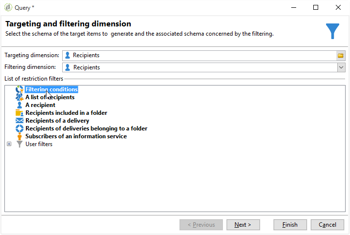
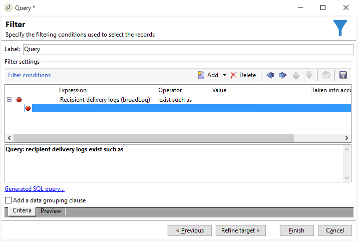
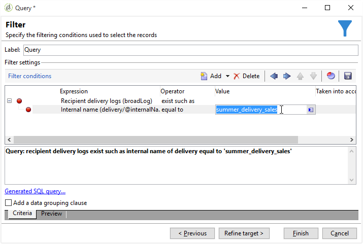
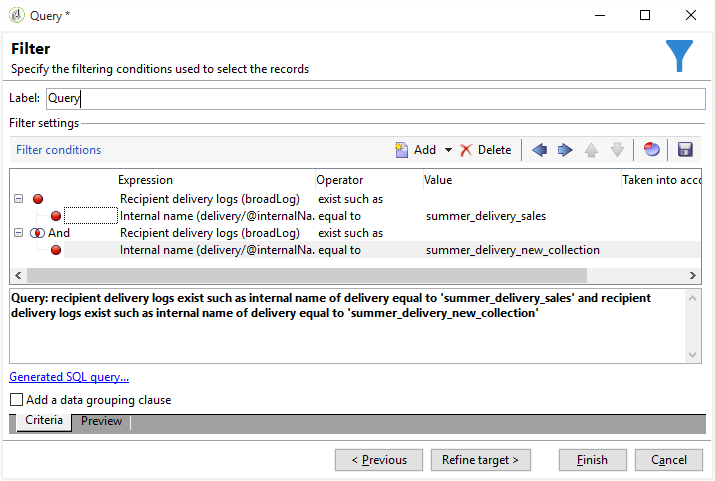

# Filtrare i destinatari duplicati {#filtering-duplicated-recipients}

In questo esempio, vogliamo filtrare i destinatari che compaiono due o più volte in una consegna per recuperare i profili duplicati.

Per creare questo esempio, attieniti alla seguente procedura:

1. Trascinare e rilasciare un&#39;attività **[!UICONTROL Query]** in un flusso di lavoro e aprire l&#39;attività.
1. Fare clic su **[!UICONTROL Edit query]** e impostare la destinazione e le dimensioni filtro su **[!UICONTROL Recipients]**.

   

1. Definisci la seguente condizione di filtro per eseguire il targeting dei destinatari esistenti nel registro di consegna. Scegliere **Registro recapito destinatari (broadlog)** nella colonna **Espressione**, scegliere **esiste come** nella colonna **Operatore**.

   

1. Definisci la seguente condizione di filtro per eseguire il targeting della consegna. Scegliere **[!UICONTROL Internal name]** nella colonna Espressione e **[!UICONTROL equal to]** nella colonna Operatore.
1. Nella colonna Valore aggiungi il nome interno della consegna di destinazione.

   

1. Con un operatore **[!UICONTROL AND]**, ripeti le stesse operazioni per eseguire il targeting di altre consegne.

   

La transizione in uscita contiene i destinatari duplicati target delle consegne.
