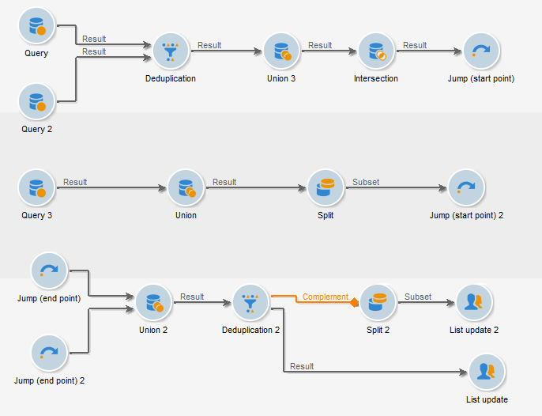
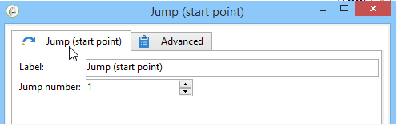

# Oggetti Jump (punto iniziale e punto finale){#jump-start-point-and-end-point}

Gli oggetti grafici di tipo **[!UICONTROL Jump]** vengono utilizzati per migliorare la leggibilità di un diagramma complesso, in particolare quello con transizioni incrociate.

I salti sono transizioni senza frecce.

Passano da un’attività all’altra, come nell’esempio seguente:

Per ogni transizione di tipo &quot;punto iniziale&quot;, è necessario posizionare una transizione di tipo &quot;punto finale&quot;.

Nello stesso flusso di lavoro è possibile inserire più salti di punti iniziali e finali. Sono identificati da un numero che deve essere inserito nei parametri:

Per migliorare la leggibilità del diagramma, è possibile modificare l&#39;immagine associata ai salti per visualizzare il numero correlato. Vedi [Cambia immagini attività](change-activity-images.md).
