# Utilizzare l’attività di approvazione locale{#using-the-local-approval-activity}

L&#39;attività **[!UICONTROL Local approval]** integrata in un flusso di lavoro di targeting consente di impostare un processo di approvazione del destinatario prima dell&#39;invio della consegna.

>[!CAUTION]
>
>Per utilizzare questa funzione, devi acquistare il modulo Marketing distribuito, che è un’opzione di Campaign. Controlla il contratto di licenza.

Per impostare questo caso d’uso, abbiamo creato il seguente flusso di lavoro di targeting:

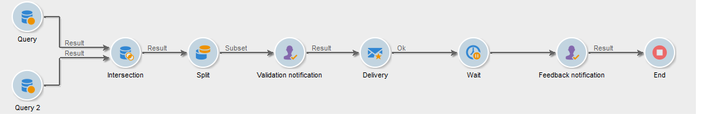

Le fasi principali del processo di approvazione locale sono:

1. La popolazione risultante dal targeting può essere limitata grazie a un&#39;attività di tipo **[!UICONTROL Split]** che utilizza un modello di distribuzione dei dati.

   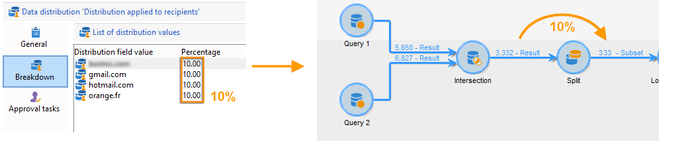

1. L&#39;attività **[!UICONTROL Local approval]** assume quindi il controllo e invia un&#39;e-mail di notifica a ogni supervisore locale. L’attività viene sospesa fino a quando ogni supervisore locale non approva i destinatari a loro assegnati.

1. Una volta raggiunta la scadenza dell’approvazione, il flusso di lavoro viene riavviato. In questo esempio, l&#39;attività **[!UICONTROL Delivery]** viene avviata e la consegna viene inviata alle destinazioni approvate.

   >[!NOTE]
   >
   >Una volta raggiunta la scadenza, i destinatari che non sono stati approvati vengono esclusi dal targeting.

   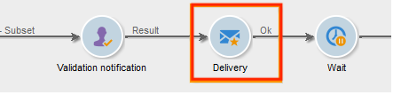

1. Pochi giorni dopo, la seconda attività di tipo **[!UICONTROL Local approval]** invia un&#39;e-mail di notifica a ogni supervisore locale con un riepilogo delle azioni eseguite dai contatti (clic, aperture, ecc.).

## Passaggio 1: creare il modello di distribuzione dei dati {#step-1--creating-the-data-distribution-template-}

Il modello di distribuzione dei dati consente di limitare la popolazione risultante dal targeting in base al raggruppamento di dati, consentendo al contempo di assegnare ogni valore a un supervisore locale. In questo esempio, il campo **[!UICONTROL Email address domain]** è stato definito come campo di distribuzione e a ogni supervisore locale è stato assegnato un dominio

Per ulteriori informazioni sulla creazione di un modello di distribuzione dati, vedere [Limitazione del numero di record di sottoinsiemi per distribuzione dati](split.md#limit-the-number-of-subset-records-per-data-distribution).

1. Per creare il modello di distribuzione dei dati, passare al nodo **[!UICONTROL Resources > Campaign management > Data distribution]** e fare clic su **[!UICONTROL New]**.

   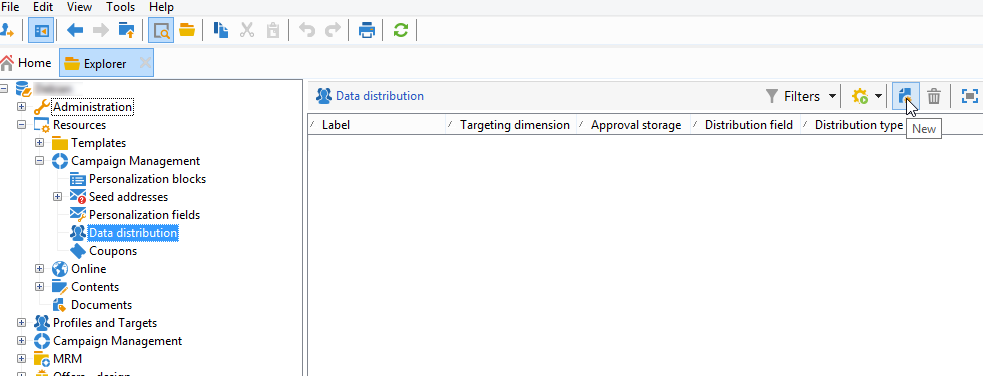

1. Seleziona la scheda **[!UICONTROL General]**.

   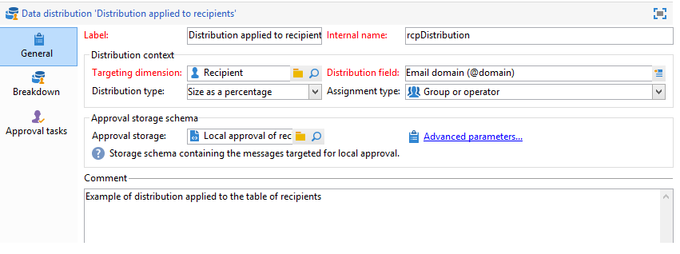

1. Immettere **[!UICONTROL Label]** e **[!UICONTROL Distribution context]**. In questo esempio, abbiamo selezionato lo schema di targeting **[!UICONTROL Recipient]** e il campo **[!UICONTROL Email domain]** come campo di distribuzione. L’elenco dei destinatari verrà suddiviso per dominio.
1. Nel campo **[!UICONTROL Distribution type]**, selezionare la modalità di espressione del valore di limitazione di destinazione nella scheda **[!UICONTROL Distribution]**. Abbiamo scelto **[!UICONTROL Percentage]**.
1. Nel campo **[!UICONTROL Approval storage]**, immettere lo schema di archiviazione delle approvazioni corrispondenti allo schema di targeting in uso. Stiamo per utilizzare lo schema di archiviazione predefinito: **[!UICONTROL Local approval of recipients]**.
1. Quindi fare clic sul collegamento **[!UICONTROL Advanced parameters]**.

   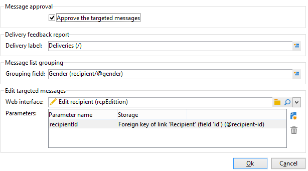

1. Mantieni selezionata l&#39;opzione **[!UICONTROL Approve the targeted messages]** in modo che tutti i destinatari siano preselezionati dall&#39;elenco di destinatari da approvare.
1. Nel campo **[!UICONTROL Delivery label]** è stata lasciata l’espressione predefinita (stringa di calcolo della consegna). L’etichetta standard della consegna verrà utilizzata nella notifica di feedback.
1. Nella sezione **[!UICONTROL Grouping field]** è stato selezionato il campo **[!UICONTROL Gender]** come campo di raggruppamento per la visualizzazione dei destinatari nelle notifiche di approvazione e feedback.
1. Nella sezione **[!UICONTROL Edit targeted messages]** sono stati selezionati l&#39;applicazione Web **[!UICONTROL Edit recipients]** e il parametro **[!UICONTROL recipientId]**. Nelle notifiche di approvazione e feedback, i destinatari saranno cliccabili e punteranno all’URL dell’applicazione web. Il parametro URL aggiuntivo sarà **[!UICONTROL recipientId]**.
1. Quindi fare clic sulla scheda **[!UICONTROL Distribution]**. Per ciascun dominio, immetti i campi seguenti:

   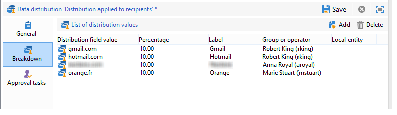

   * **[!UICONTROL Value]**: immettere il valore del nome di dominio.
   * **[!UICONTROL Percentage / Fixed]**: per ogni dominio, immettere il valore massimo. numero di destinatari a cui desideri inviare la consegna. In questo esempio, vogliamo limitare la consegna al 10% per dominio.
   * **[!UICONTROL Label]**: immettere l&#39;etichetta del dominio da visualizzare nelle notifiche di approvazione e feedback.
   * **[!UICONTROL Group or operator]**: selezionare l&#39;operatore o il gruppo di operatori assegnati al dominio.

     >[!CAUTION]
     >
     >Assicurati che agli operatori siano stati assegnati i diritti appropriati.

## Passaggio 2: creare il flusso di lavoro di targeting {#step-2--creating-the-targeting-workflow}

Per impostare questo caso d’uso, abbiamo creato il seguente flusso di lavoro di targeting:

Sono state aggiunte le seguenti attività:

* Due **[!UICONTROL Query]** attività,
* Un&#39;attività **[!UICONTROL Intersection]**,
* Un&#39;attività **[!UICONTROL Split]**,
* Un&#39;attività **[!UICONTROL Local approval]**,
* Un&#39;attività **[!UICONTROL Delivery]**,
* Un&#39;attività **[!UICONTROL Wait]**,
* Una seconda attività **[!UICONTROL Local approval]**,
* Un&#39;attività **[!UICONTROL End]**.

### Query, intersezione e suddivisione {#queries--intersection-and-split}

Il targeting a monte è costituito da due query, una di intersezione e una di divisione. La popolazione risultante dal targeting può essere limitata utilizzando un&#39;attività **[!UICONTROL Split]** utilizzando un modello di distribuzione dei dati.

Per ulteriori informazioni sulla configurazione di un&#39;attività divisa, consulta [Divisione](split.md). La creazione di un modello di distribuzione dati è descritta in [Limitazione del numero di record di sottoinsiemi per distribuzione dati](split.md#limit-the-number-of-subset-records-per-data-distribution).

Se non si desidera limitare il gruppo della query, non è necessario utilizzare le attività **[!UICONTROL Query]**, **[!UICONTROL Intersection]** e **[!UICONTROL Split]**. In questo caso, completare il modello di distribuzione dati nella prima attività **[!UICONTROL Local approval]**.

1. Nella sezione **[!UICONTROL Record count limitation]**, selezionare l&#39;opzione **[!UICONTROL Limit the selected records]** e fare clic sul collegamento **[!UICONTROL Edit]**.

   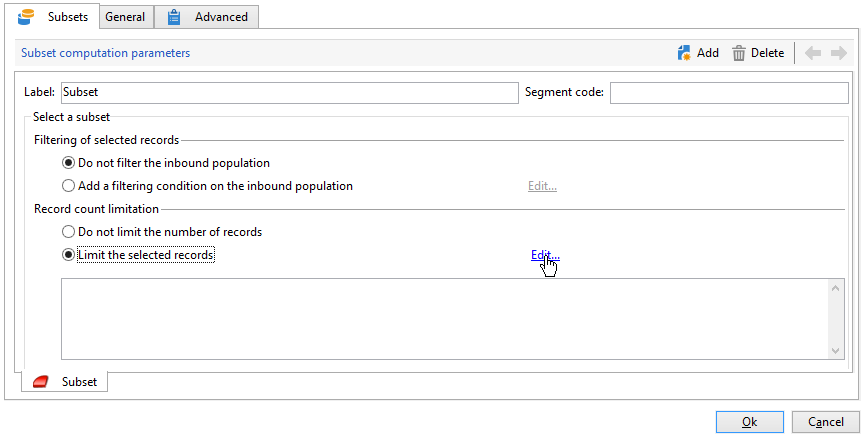

1. Selezionare l&#39;opzione **[!UICONTROL Keep only the first records after sorting]** e fare clic su **[!UICONTROL Next]**.

   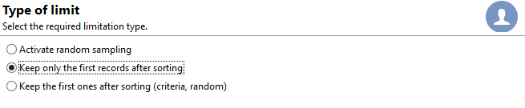

1. Nella sezione **[!UICONTROL Sort columns]**, aggiungi il campo a cui viene applicato l&#39;ordinamento. In questo caso, è stato scelto il campo **[!UICONTROL Email]**. Fai clic su **[!UICONTROL Next]**.

   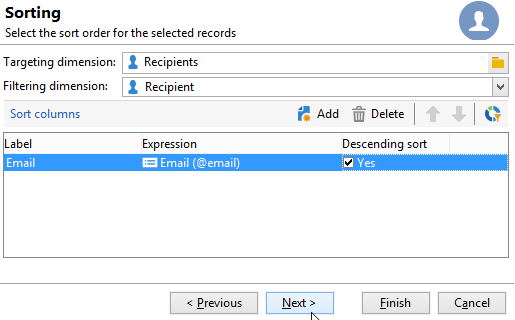

1. Selezionare l&#39;opzione **[!UICONTROL By data distribution]**, selezionare il modello di distribuzione creato in precedenza (fare riferimento a [Passaggio 1: Creazione del modello di distribuzione dei dati](#step-1--creating-the-data-distribution-template-)) e fare clic su **[!UICONTROL Finish]**.

   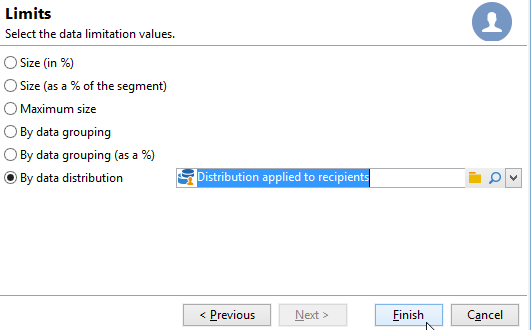

Nel modello di distribuzione, abbiamo scelto di limitare la popolazione al 10% per valore di raggruppamento, che coincide con i valori visualizzati nel flusso di lavoro (340 come input e 34 come output).

### Notifica di approvazione {#approval-notification}

L&#39;attività **[!UICONTROL Local approval]** consente di inviare una notifica a ogni supervisore locale.

Per ulteriori informazioni sulla configurazione dell&#39;attività **[!UICONTROL Local approval]**, vedere [Approvazione locale](local-approval.md).

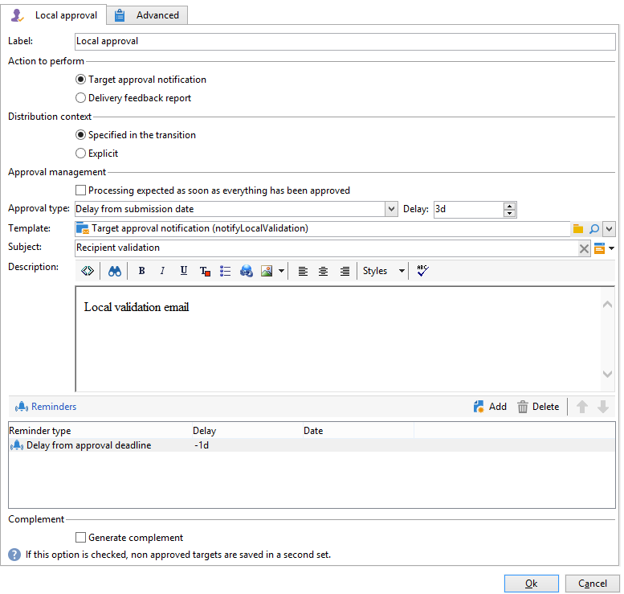

È necessario inserire i campi seguenti:

1. Nella sezione **[!UICONTROL Action to execute]**, seleziona l’opzione **[!UICONTROL Target approval notification]**.
1. Nella sezione **[!UICONTROL Distribution context]**, seleziona l’opzione **[!UICONTROL Specified in the transition]**.

   Se non si desidera limitare la popolazione di destinazione, selezionare l&#39;opzione **[!UICONTROL Explicit]** e immettere il modello di distribuzione creato in precedenza nel campo **[!UICONTROL Data distribution]**.

1. Nella sezione **[!UICONTROL Notification]**, seleziona il modello di consegna e l’oggetto da utilizzare per l’e-mail di notifica. Abbiamo scelto il modello predefinito: **[!UICONTROL Local approval notification]**.
1. Nella sezione **[!UICONTROL Approval schedule]**, è stata mantenuta la scadenza dell&#39;approvazione predefinita (3 giorni) ed è stato aggiunto un promemoria. La consegna partirà 3 giorni dopo l’inizio dell’approvazione. Una volta raggiunta la scadenza dell’approvazione, i destinatari che non sono stati approvati non vengono presi in considerazione dal targeting.

L&#39;attività **[!UICONTROL Local approval]** invia un&#39;e-mail di notifica ai supervisori locali.

### Attendere {#wait}

L’attività Attendi ti consente di posticipare l’inizio della seconda attività di approvazione locale che invierà la notifica di feedback della consegna. Nel campo **[!UICONTROL Duration]** è stato immesso il valore **[!UICONTROL 5d]** (5 giorni). Le azioni eseguite dai destinatari nei 5 giorni successivi all’invio della consegna verranno incluse nella notifica di feedback.

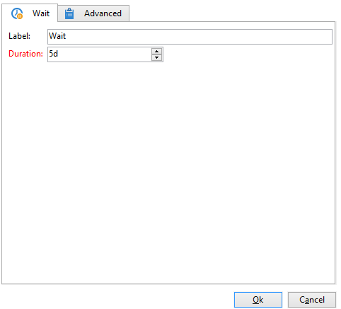

### Notifica di feedback {#feedback-notification}

La seconda attività **[!UICONTROL Local approval]** ti consente di inviare una notifica di feedback della consegna a ogni supervisore locale.

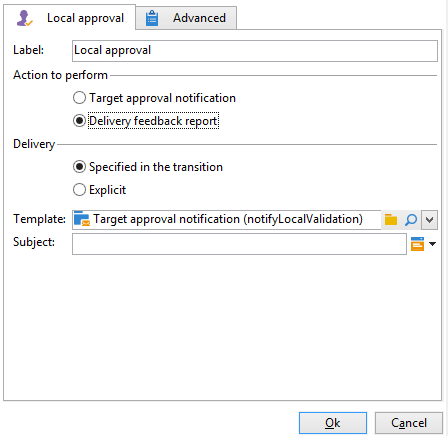

È necessario immettere i campi seguenti.

1. Nella sezione **[!UICONTROL Action to execute]** scegliere **[!UICONTROL Delivery feedback report]**.
1. Nella sezione **[!UICONTROL Delivery]** scegliere **[!UICONTROL Specified in the transition]**.
1. Nella sezione **[!UICONTROL Notification]**, seleziona il modello di consegna e l’oggetto da utilizzare per l’e-mail di notifica.

Una volta raggiunta la scadenza configurata nell&#39;attività Attendi, la seconda attività di tipo **[!UICONTROL Local approval]** invia la seguente e-mail di notifica a ogni supervisore locale:

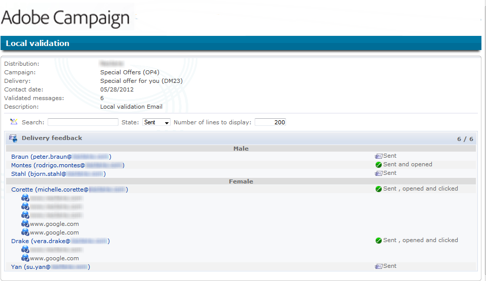

### Tracciamento dell’approvazione da parte dell’amministratore {#approval-tracking-by-the-administrator}

A ogni avvio dell&#39;attività di approvazione locale viene creata un&#39;attività di approvazione. L&#39;amministratore può controllare ciascuna di queste attività di approvazione.

Vai al flusso di lavoro di targeting della campagna e fai clic sulla scheda **[!UICONTROL Local approval tasks]**.

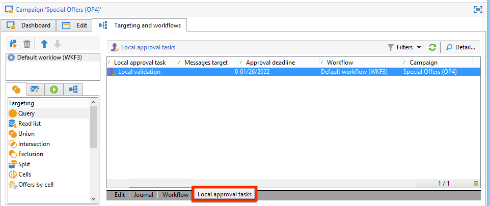

È inoltre possibile accedere all&#39;elenco delle attività di approvazione locali tramite la scheda **[!UICONTROL Approval tasks]** del modello di distribuzione dei dati.

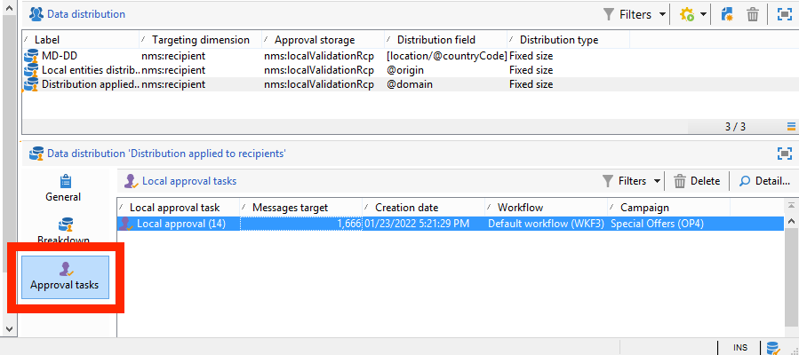

Selezionare l&#39;attività da monitorare e fare clic sul pulsante **[!UICONTROL Detail]**. La scheda **[!UICONTROL General]** dell&#39;attività di approvazione locale consente di visualizzare informazioni sull&#39;attività. Se necessario, puoi modificare le date di approvazione e promemoria.

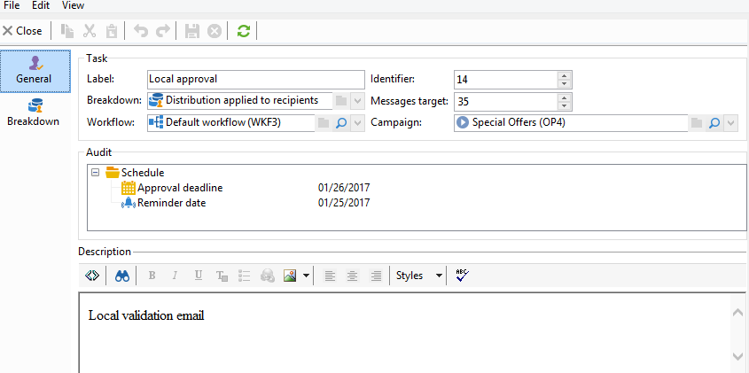

Questa scheda mostra le seguenti informazioni:

* l’etichetta dell’attività e il relativo ID
* il modello di distribuzione utilizzato
* il numero di messaggi target
* il flusso di lavoro e la campagna collegati
* la pianificazione delle attività

La scheda **[!UICONTROL Distribution]** per l&#39;attività ti consente di visualizzare i registri di approvazione, il loro stato, il numero di messaggi target, la data di approvazione, nonché l&#39;operatore che ha approvato la consegna.

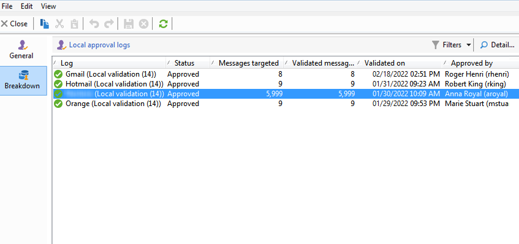

Selezionare un registro di approvazione e fare clic sul pulsante **[!UICONTROL Detail]** per visualizzare ulteriori informazioni. La scheda **[!UICONTROL General]** del registro di approvazione locale consente di visualizzare le informazioni generali del registro. Puoi anche modificare lo stato di approvazione.

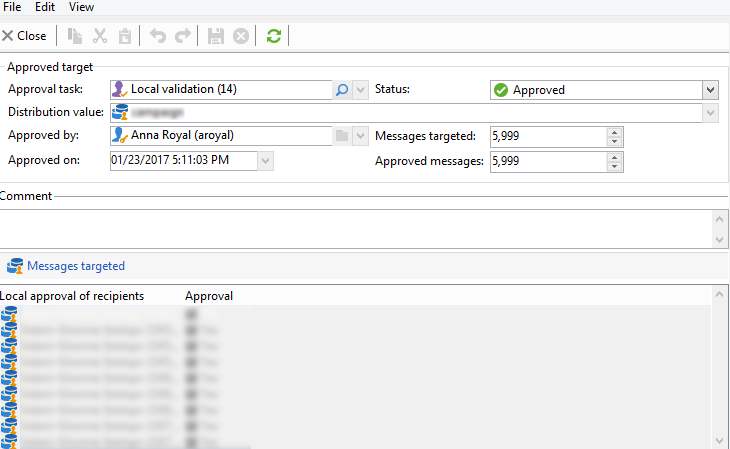

Questa scheda mostra le seguenti informazioni:

* l&#39;attività di approvazione collegata
* lo stato di approvazione (**[!UICONTROL Approved]** o **[!UICONTROL Pending]**)
* il modello di distribuzione utilizzato
* il supervisore locale che ha approvato e la data di approvazione
* il numero di messaggi target e approvati

Nella scheda **[!UICONTROL Targeted]** del registro di approvazione viene visualizzato l&#39;elenco dei destinatari e il relativo stato di approvazione. Se necessario, puoi modificare questo stato.

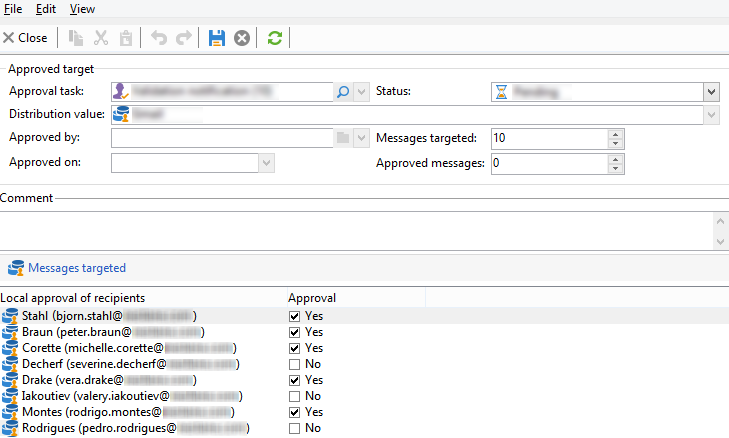
