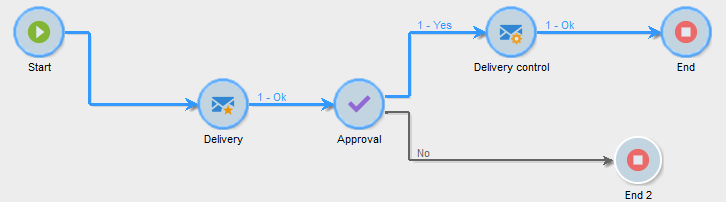
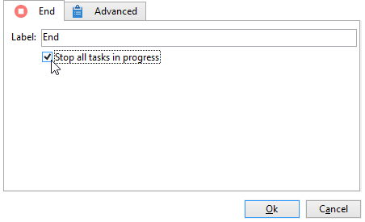
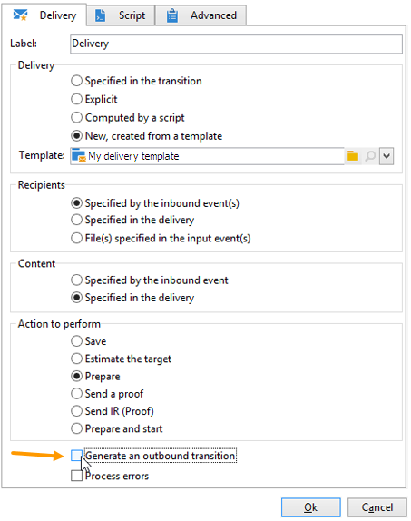

# Attività Start e End{#start-and-end}

Le attività **[!UICONTROL Start]** e **[!UICONTROL End]** ti consentono di contrassegnare graficamente l&#39;inizio e la fine di un flusso di lavoro. Queste attività non hanno alcun impatto funzionale e sono pertanto facoltative.

* **[!UICONTROL Start]**

  L’esecuzione di un flusso di lavoro inizia con le attività senza una transizione in entrata e le attività di tipo Start.

  

* **[!UICONTROL End]**

  È possibile configurare l&#39;attività **[!UICONTROL End]** per interrompere tutte le attività in corso. A questo scopo, fai doppio clic sull’attività per visualizzarne le proprietà e seleziona l’opzione appropriata.

  

  I dati nella tabella di lavoro vengono eliminati automaticamente quando l&#39;attività finale è abilitata. Se non è necessario e per evitare carichi superflui, puoi scegliere di disabilitare la transizione all’ultimo output dell’attività. Ad esempio, a un output di consegna, se non è pianificato alcun processo, deseleziona l’opzione pertinente come mostrato di seguito:

  
