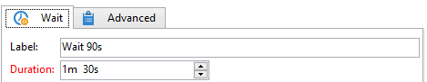

# Attendere{#wait}

Un&#39;attività **Wait** attiva la relativa transizione dopo un ritardo di tempo compreso tra alcuni secondi e diversi mesi. Un’attività in attesa non blocca l’esecuzione di altre attività; il flusso di lavoro può eseguire le attività in parallelo mentre questa attività è in sospeso.

Puoi immettere l’etichetta e il tempo di attesa utilizzando l’editor, come nell’esempio seguente:

Nel campo **[!UICONTROL Duration]**, il valore può essere espresso nell&#39;unità scelta: (in base alle impostazioni internazionali dell&#39;operatore):

* Se le impostazioni internazionali non sono specificate: **s** per secondi, **m** per minuti, **h** per ore, **d** per giorni, **y** per anni. Al momento dell’omologazione, il valore viene automaticamente convertito nell’unità più leggibile.

  L&#39;unità predefinita è il giorno (**d**).

* Se, ad esempio, le impostazioni internazionali sono impostate su &quot;Français&quot;: **s** per secondi, **mn** per minuti, **h** per ore, **j** per giorni, **m** per mesi, **a** per anni. Al momento dell&#39;approvazione, il valore viene automaticamente convertito nell&#39;unità più leggibile, come nell&#39;esempio precedente **90s** è stato convertito in **1mn 30s**.

  L&#39;unità predefinita è il giorno (**d**).
