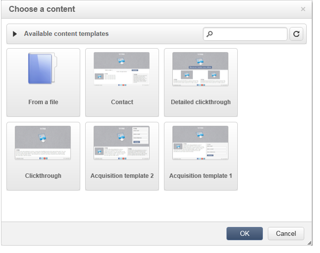
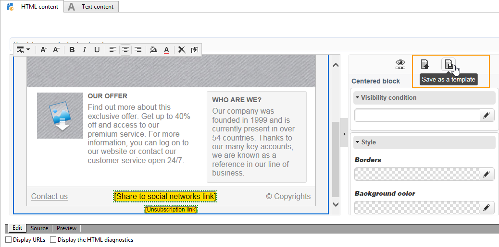

# Gestione dei modelli{#template-management}

Digital Content Editor offre **modelli standard** per applicazioni Web e consegne.

Durante la creazione di un&#39;applicazione Web di tipo Pagina di destinazione, l&#39;utente può scegliere uno di questi modelli. Puoi anche importare un modello HTML creato al di fuori di Adobe Campaign.

Per aggiungere un modello, consulta [Opzioni globali](content-editor-interface.md#global-options).

## Salvataggio di una consegna come modello {#saving-a-delivery-as-a-template}

Dopo aver configurato una consegna, puoi salvarla come modello per riutilizzarla per le consegne future.

Nella scheda **Campagne**, apri la consegna scelta. Fare clic sul pulsante **Salva come modello**, assegnare un nome al modello e quindi salvare.

Il nuovo modello viene salvato nel nodo **Risorse > Modelli > Modelli di contenuto** in Esplora risorse.
