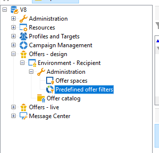
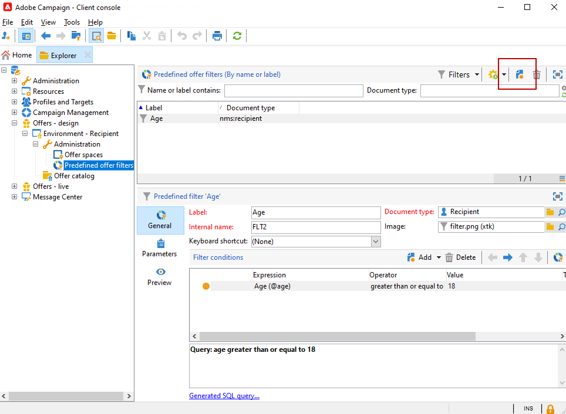
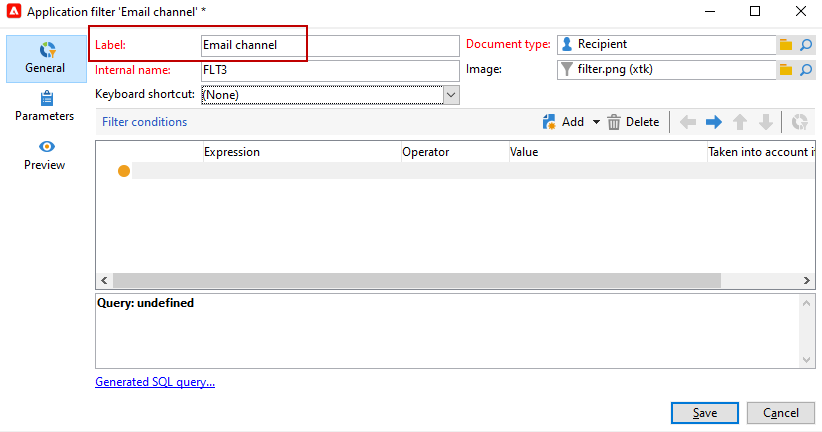
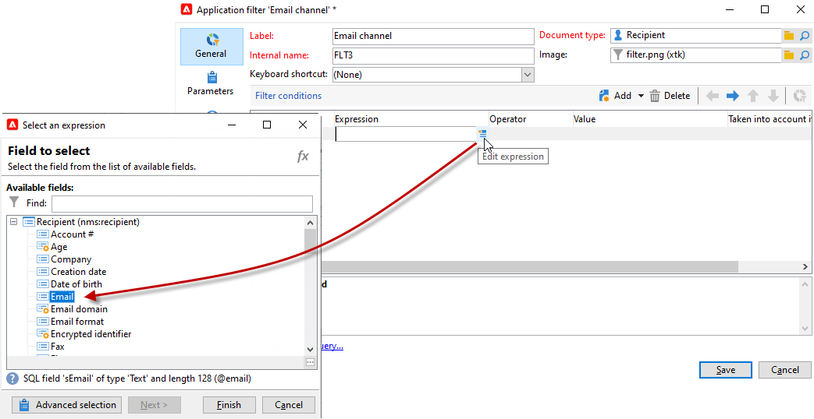

# Creare filtri predefiniti{#creating-pre-defined-filters}

Crea filtri predefiniti per definire le regole di idoneità per la popolazione target, che possono essere facilmente riutilizzate durante la creazione dell’offerta. Sono specifici per ogni ambiente e tengono conto dei parametri dell’offerta.

>[!NOTE]
>
>L’interfaccia web di Adobe Campaign offre un’interfaccia intuitiva per gestire e personalizzare facilmente i filtri predefiniti in base alle tue esigenze specifiche. Crea una sola volta e salva per un utilizzo futuro. Per ulteriori informazioni sui filtri predefiniti per l&#39;interfaccia utente Web, consulta la [documentazione dell&#39;interfaccia utente Web di Adobe Campaign](https://experienceleague.adobe.com/it/docs/campaign-web/v8/start/predefined-filters){target=_blank}.

Per creare un filtro predefinito, applica il seguente processo:

1. Individuare la cartella **[!UICONTROL Administration]** e selezionare **[!UICONTROL Pre-defined offer filters]**.

   

1. Fai clic su **[!UICONTROL New]**.

   

1. Modifica l’etichetta per poter identificare il filtro in un secondo momento.

   

1. Seleziona il campo che verrà interessato dalla condizione di filtro.

   

1. Seleziona un operatore e un valore, se necessario, quindi salva la query.

   

1. Fare clic su **[!UICONTROL Preview]** per visualizzare il risultato del filtro.

   
