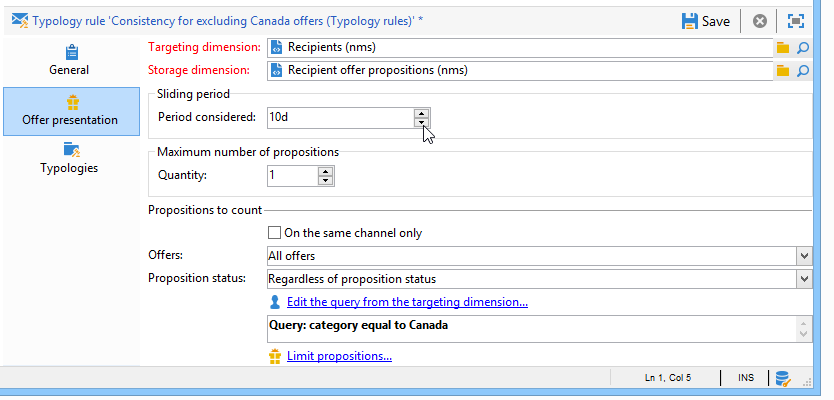
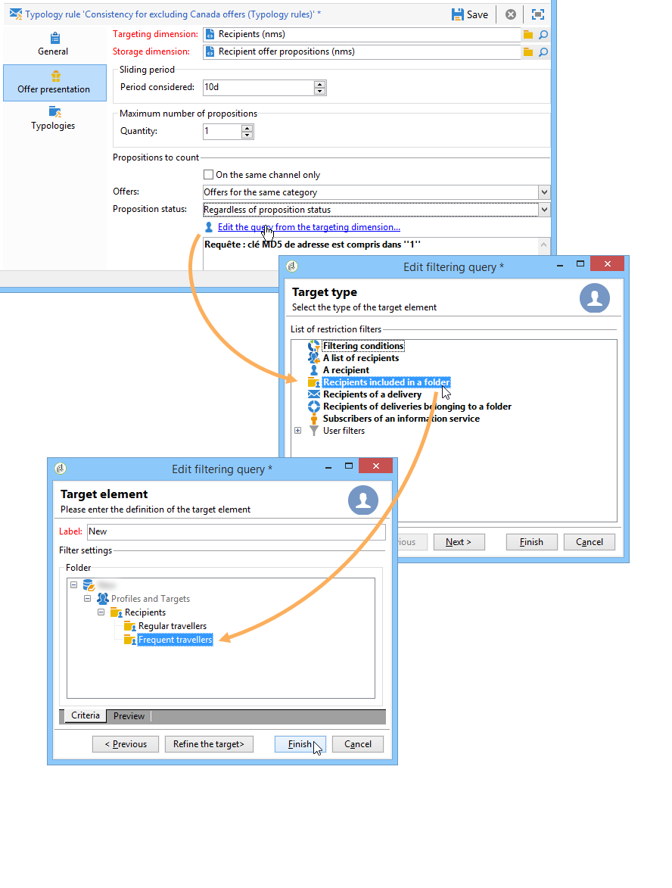
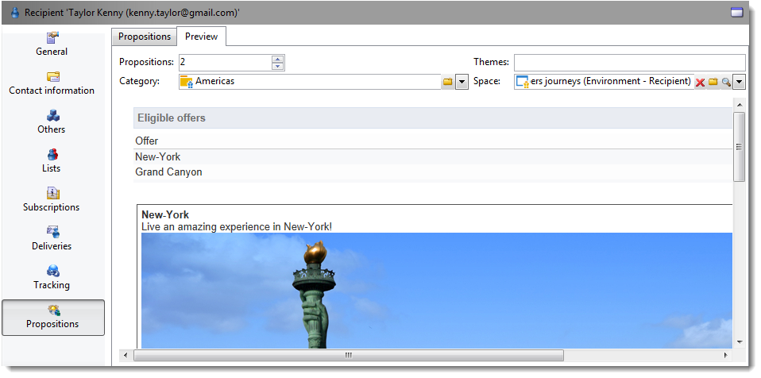

# Regole di presentazione{#presentation-rules}

## Creazione di una regola di presentazione {#creating-a-presentation-rule}

Nel nostro database, ci sono diverse offerte di viaggio per Europa, Africa, Stati Uniti e Canada. Vogliamo inviare offerte per un viaggio in Canada, ma se il destinatario rifiuta questo tipo di offerta, non vogliamo inviarle di nuovo.

Stiamo per configurare la nostra regola in modo che il viaggio in Canada venga offerto solo una volta per destinatario e non nuovamente se rifiutato.

1. Nella struttura Adobe Campaign, passa al nodo **[!UICONTROL Administration]** > **[!UICONTROL Campaign management]** > **[!UICONTROL Typology management]** > **[!UICONTROL Typology rules]**.
1. Crea una nuova regola di tipo **[!UICONTROL Offer presentation]**.

   

1. Se necessario, modifica l’etichetta e la descrizione.

   

1. Scegliere l&#39;opzione **[!UICONTROL All channels]** per estendere la regola a tutti i canali.

   

1. Fare clic sul collegamento **[!UICONTROL Edit expression]** e scegliere il nodo **[!UICONTROL Category]** come espressione.

   

1. Scegli la categoria corrispondente alla tua offerta di viaggio per il Canada e fai clic su **[!UICONTROL OK]** per chiudere la finestra della query.

   

1. Nella scheda **[!UICONTROL Offer presentation]**, scegli le stesse dimensioni configurate nell&#39;ambiente.

   

1. Specifica il periodo durante il quale la regola verrà applicata.

   

1. Limita la proposta a uno in modo che i destinatari che hanno già rifiutato un viaggio in Canada non ricevano un’altra offerta simile.

   

1. Selezionare il filtro **[!UICONTROL Offers for the same category]** per escludere tutte le offerte dalla categoria **Canada**.

   

1. Selezionare il filtro **[!UICONTROL Rejected propositions]** per tenere conto solo delle proposte rifiutate dal destinatario.

   

1. Scegli i destinatari per i quali applicare questa regola.

   Nel nostro esempio, sceglieremo i **destinatari frequenti**.

   

1. Fai riferimento alla regola in una tipologia di offerta.

   

1. Vai all&#39;ambiente dell&#39;offerta (**Ambiente - Destinatario** in questo caso) e fai riferimento alla nuova tipologia appena creata utilizzando l&#39;elenco a discesa nella scheda **[!UICONTROL Eligibility]**.

   

## Applicazione della regola di presentazione {#applying-the-presentation-rule}

Esempio di applicazione della regola di tipologia creata in precedenza.

Desideriamo inviare una proposta di prima offerta appartenente alla categoria Canada. Se l’offerta viene rifiutata una volta da uno dei destinatari, non verrà più offerta loro.

1. Nella cartella dei destinatari **Viaggiatori frequenti**, scegli uno dei profili per verificare le offerte per le quali sono idonei: fai clic sulla scheda **[!UICONTROL Propositions]**, quindi sulla scheda **[!UICONTROL Preview]**.

   Nel nostro esempio, **Tim Ramsey** è idoneo per un&#39;offerta che fa parte della categoria **Americhe**.

   

1. Inizia creando una consegna e-mail che eseguirà il targeting dei **destinatari frequenti** con le offerte.
1. Seleziona i parametri di richiamo del motore di offerta.

   Nel nostro esempio, viene scelta la categoria **Viaggi in America**, che contiene le sottocategorie **Canada** e **Stati Uniti**.

   

1. Inserisci le offerte nel corpo del messaggio e invia la consegna. Per ulteriori informazioni, consulta [Informazioni sui canali in uscita](https://experienceleague.adobe.com/it/docs/campaign/campaign-v8/offers/interaction-send-offers){target="_blank"} (documentazione di Campaign v8).

   Il destinatario ha ricevuto l’offerta per la quale è idoneo.

1. Il destinatario ha rifiutato l’offerta canadese, come mostrato nella cronologia delle proposte.

   

1. Controlla le offerte per le quali sono ora idonee.

   Possiamo vedere che non viene scelta alcuna offerta per il Canada.

   
