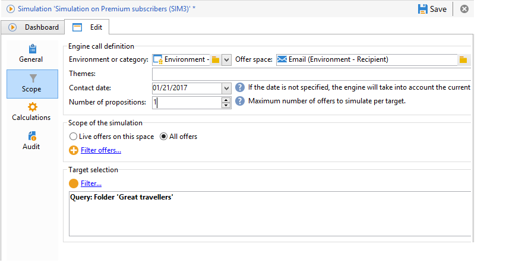
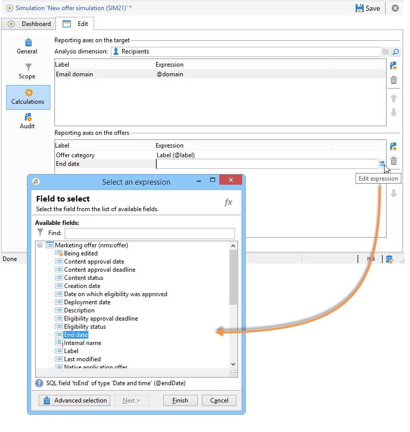

# Ambito della simulazione{#simulation-scope}

## Definizione del campo di applicazione {#definition-of-the-scope}

Apri la scheda **[!UICONTROL Scope]** per scegliere le impostazioni.

I seguenti elementi sono obbligatori:

* Ambiente o categoria di offerta.
* Spazio dell’offerta.
* Data di contatto. Le offerte non idonee alla data di contatto non vengono prese in considerazione.
* Popolazione target.

  Se non configuri un filtro sulla destinazione, verrà presa in considerazione l’intera tabella dei destinatari.

* Numero di proposte da simulare per target.

  Il destinatario riceverà un numero così elevato di proposte. Ad esempio, se immetti 5, ogni destinatario riceverà un massimo di 5 proposte di offerta.

  

Per perfezionare le offerte da prendere in considerazione per la simulazione, puoi aggiungere uno o più temi (precedentemente specificati nelle categorie).

Puoi anche scegliere di eseguire la simulazione su tutte le offerte o solo su quelle online. Alcuni filtri ti consentono di modificare la selezione, se lo desideri.

>[!NOTE]
>
>Specificare una data di contatto. In questo modo il motore di interazione può ordinare le offerte nell’ambiente o nella categoria selezionati. Se non è configurata alcuna data, la simulazione genera un errore.

## Aggiunta di assi di reporting {#adding-reporting-axes}

È possibile migliorare l&#39;analisi di simulazione aggiungendo assi di reporting sul target o sulle offerte stesse tramite la scheda **[!UICONTROL Calculations]**.

A tale scopo, fare clic sul pulsante **[!UICONTROL Add]** e scegliere i campi appropriati. Gli assi vengono utilizzati per il calcolo della simulazione e vengono visualizzati nel rapporto di analisi. Per ulteriori informazioni, consulta [Tracciamento della simulazione](simulation-tracking.md).

